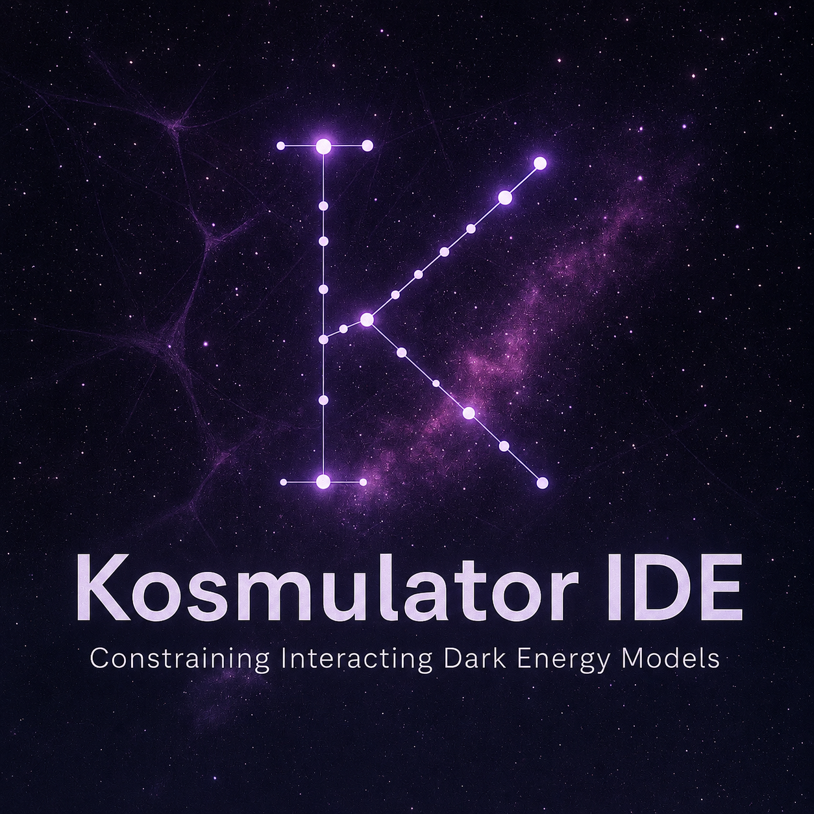

<p align="center">
  
</p>

# Kosmulator: A Python framework for cosmological inference with MCMC

Kosmulator is a Python package utilising **Zeus** and **EMCEE (The MCMC Hammer)** to perform efficient, vectorised Markov Chain Monte Carlo (MCMC) simulations for studying **modified gravity** and **alternative cosmological models**.

The package is designed to be **modular**, **flexible**, and **user-friendly**, allowing researchers to easily configure inference runs, combine multiple sets of cosmological observations, and produce high-quality statistical summaries and visualisations.

---

## Features

- **Flexible Cosmological Inference Framework**  
  Run Bayesian inference pipelines for ΛCDM, modified gravity, and alternative cosmologies using a modular, model-agnostic architecture.

- **Multiple MCMC Backends**  
  Supports both **Zeus** and **EMCEE**, with automatic or user-controlled sampler selection and convergence diagnostics.

- **Vectorised Likelihood Evaluation**  
  Efficient vectorised likelihood computations for fast sampling across large parameter spaces and combined datasets.

- **Wide Range of Observational Data**  
  Built-in support for:
  - Type Ia Supernovae (JLA, Pantheon, Pantheon+, Union3, DES-Y5)
    - `JLA` is the official 740-SN likelihood (Betoule et al. 2014): `alpha_JLA` and `beta_JLA` are sampled, the absolute magnitudes (with the host-mass step) are fitted analytically, and the covariance is rebuilt for each alpha, beta. See `Observations/JLA/README.md`.
    - `JLA_legacy` is the old 359-SN file used as "JLA" before October 2026, kept only to reproduce earlier runs.
  - Baryon acoustic oscillations from DESI, all read in the same format:
    - `DESI_DR2`: DESI DR2, 13 measurements with the published covariance.
    - `DESI_DR1`: DESI DR1, all 12 measurements with the published covariance.
    - `BAO`: the 10 anisotropic DESI DR1 measurements (D_M/r_d and D_H/r_d), without the BGS and QSO D_V/r_d points.
    - Before October 2026 the `BAO` and `DESI_DR1` tags were the other way round: older results labelled `BAO` are the 12-point DR1 set and older `DESI_DR1` results the 10-point set.
  - Cosmic Chronometers / OHD
  - Growth of structure (fσ₈ and f)
  - Cosmic Microwave Background (Planck 2018 via CLIK)
  - Big Bang Nucleosynthesis (D/H, BBN_PryMordial, including AlterBBN-based likelihoods)

- **Automatic Parameter Injection & Dataset Awareness**  
  Parameters (including nuisance parameters) are automatically added or fixed based on selected observational datasets.

- **Sound Horizon (r_d) Policy Management**  
  Centralised handling of the sound horizon with support for fixed, free, CLASS-derived, or BBN-calibrated treatments depending on data combinations.

- **CLASS Integration with Caching**  
  Seamless integration with **CLASS**, including model-specific binary caching for fast reuse across runs and multiprocessing environments.

- **Publication-Ready Output & Visualisation**  
  Generates corner plots, best-fit theory comparisons, autocorrelation diagnostics, and LaTeX-ready statistical tables with a consistent directory structure.

- **Chain Reuse and Resume Capability**  
  Reload, resume, or extend existing MCMC chains for reproducibility and efficient experimentation.

- **Environment Diagnostics**  
  Includes a built-in `kosmulator-doctor` command that checks the installation and, with `--setup`, builds CLASS and makes a short test run.

---

## Requirements

Kosmulator is written in Python and supports a modular backend system. Some dependencies are always required, 
while others are required only when specific observational datasets are used.

#### Core Python Dependencies (required for all runs)

- **Python ≥ 3.9** - Recommend Python 3.11
- **NumPy**
- **SciPy**
- **Matplotlib**
- **h5py**
- **Pandas**
- **GetDist** (corner plots and statistical visualisation)
- **EMCEE** (MCMC sampler)
- **Zeus** (vectorised MCMC sampler)
- **tqdm**, **threadpoolctl**
- **Cython**, **setuptools** and a **C/C++ compiler with make**, for the CLASS builds (CMB groups, and r_d in BAO/DESI groups calibrated by BBN or the CMB)

#### CMB-Specific Dependencies (required only when CMB likelihoods are used)

- **CLASS (classy)**  
  Used to compute background and perturbation quantities and CMB power spectra. Kosmulator builds it itself, per model, from `Class/<model>`; no separate CLASS installation is needed.
- **Planck likelihood code: CLIK or clipy**  
  Required for Planck CMB likelihoods (TT, TTTEEE, low-ℓ, lensing).  
  The easiest route is clipy, the pure-Python implementation of CLIK by K. Benabed and L. Balkenhol (https://github.com/benabed/clipy): `pip install "clipy-like>=0.15"`. Kosmulator uses CLIK when it is installed and clipy otherwise; both read the same `.clik` folders, and the run log records which one was used. clipy 0.15's low-ℓ EE likelihood (SimAll, tag `CMB_lowl`) needs NumPy 2.0 or newer; with an older NumPy, Kosmulator stops at start-up and asks for CLIK for that tag.  
  The corresponding `.clik` likelihood directories are in `Observations/`.
- **candl** (`pip install "candl-like>=2.0.3"`) for ACT DR6 and SPT-3G D1, and **act_dr6_lenslike** for the ACT DR6 lensing likelihood
- **Astropy** (installed with clipy)

#### Optional Dependencies

- **AlterBBN**  
  Optional backend for Big Bang Nucleosynthesis (BBN) D/H likelihoods.  
  Kosmulator supports approximate BBN likelihoods without AlterBBN, as well as physically motivated predictions using live AlterBBN calls or precomputed grids. The AlterBBN grid `BBN_DH_AlterBBN` uses by default is included (`Observations/BBN/bbn_grid.npz`), so AlterBBN itself is only needed for live calls or a new grid.

- **mpi4py** and **schwimmbad**  
  For MPI runs (`--use_mpi`, clusters).

- **LaTeX (TeX Live / MiKTeX)**  
  Strongly recommended for publication-quality plots and LaTeX-ready tables. See Latex installation section at the end for additional information.

---

## Installation
Kosmulator runs on Linux, macOS and Windows through WSL2. On WSL, clone it into your Linux home folder (`~/`), not into `/mnt/c` or `/mnt/d`: reading and writing files there is much slower.

**Recommended: conda** ([Miniforge](https://github.com/conda-forge/miniforge)). The environment brings everything, including the C compiler Kosmulator uses to build CLASS, so nothing needs `sudo`:
```bash
git clone --depth 1 https://github.com/renierht/Kosmulator.git
cd Kosmulator
conda env create -f environment.yml
conda activate kosmulator
kosmulator-doctor --setup
```
`kosmulator-doctor --setup` checks the installation, builds CLASS for LCDM_v and rd_Class (a few minutes, once), loads every likelihood with its data and makes a short test run. Anything missing is listed with the command that adds it. Run `kosmulator-doctor` (without `--setup`) at any time for a quick check.

**Without conda (pip).** Use a clean virtual environment with Python 3.9 - 3.12 (3.11 recommended) and a C/C++ compiler (Ubuntu/WSL: `sudo apt install build-essential python3-dev`; macOS: `xcode-select --install`):
```bash
git clone --depth 1 https://github.com/renierht/Kosmulator.git
cd Kosmulator
python3 -m venv .venv && source .venv/bin/activate
pip install -e ".[all]"
kosmulator-doctor --setup
```
`pip install -e .` installs the core only (enough for the late-time data); `".[cmb]"` adds the CMB likelihood codes (clipy, candl, act_dr6_lenslike), `".[mpi]"` adds MPI (mpi4py and schwimmbad; it needs an MPI library, e.g. `sudo apt install mpich`), and `".[all]"` both.

You do not have to install CLASS or the Planck likelihood code yourself. Kosmulator builds its own CLASS for each model from `Class/<model>` on first use, and the Planck, ACT DR6, SPT-3G and lensing data are in `Observations/` (read by clipy, the pure-Python implementation of CLIK by K. Benabed and L. Balkenhol, and by candl). A model with its own modified CLASS goes in `Class/<model>`; `kosmulator-doctor --build-class <model>` builds it straight away, so that compiler errors show before a run.

If the SPT-3G D1 files are ever missing or changed in your copy, `python -m Kosmulator_main.get_spt_data` downloads and checks them again; for the MUSE lensing file add `--muse-zip` with the zip from https://pole.uchicago.edu/public/data/ge25/ (`Observations/candl/README.md`, `Observations/spt3g_muse_lensing/README.md`).
Note: the optional extras (compiled CLIK instead of clipy, live AlterBBN, LaTeX for the plot labels) are in the Advanced installation section at the end.

---


## Quick Test
Run Kosmulator in your terminal.
``` bash
python Kosmulator.py 
```
If it ran successfully, it has been installed correctly!

## Configure Kosmulator Guide

#### Step 1: Define a New Model
Modify User_defined_modules.py to register your model parameters, and background expansion.
	- Implement E(z) for a new background model (flat or not).
	- (Optionally) define additional sanity restrictions for your model's free parameters.
	- Register the model name + parameter list in the model registry.
	- (Optional) expose CMB Cl wrappers for that model. Needed to fit to CMB observation

#### Step 2: Select Datasets 
In `Kosmulator.py`, select observation datasets. Observations are specified as lists of likelihood groups.
```python
# Run 1: JLA only | Run 2: OHD only | Run 3: Joint CC, OHD, and Pantheon
observations = [ ["JLA"], ["OHD"], ["CC", "OHD", "Pantheon"] ]
```

#### Step 3: Select model and configure MCMC Run
In `Kosmulator.py`, configure the MCMC sampler and specify the model names you want to analyse:

Specify the model names you want to analyse:
```python
# Models implemented in User_defined_modules.py
model_names: List[str] = ["Your_model_name"] 

reference_model: str = "LCDM_v"  # Against which model you want to test it

# Sampler settings
nwalkers: int = 16
nsteps: int = 500
burn: int = 10
convergence: float = 0.05  # Stability of tau_max between checks (relative) required by the convergence rule
sample_H0_uncalibrated_SNe: bool = False  # see below
```

Uncalibrated supernovae without BAO/DESI or an H0 anchor (for example `["Pantheon"]`, `["JLA", "DESY5"]` or `["f", "PantheonP"]`; anchors are `CC`, `OHD`, `PantheonPS` and the CMB) do not constrain H_0: the analytically marginalised magnitude offset absorbs 5 log10 H_0. By default H_0 is then not sampled and distances use `reference_values["H_0"]`, which changes no chi^2. With `sample_H0_uncalibrated_SNe = True` H_0 is sampled anyway, so its posterior is the prior. It is not counted in k in either case, so chi^2, AIC, BIC and the degrees of freedom do not depend on the switch.

##### Planck 2018 CMB likelihoods
| Tag | Likelihood (folder in `Observations/`) | Planck 2018 name |
|---|---|---|
| `CMB_hil` | plik TT,TE,EE, ℓ = 30 - 2508 (`plik_rd12_HM_v22b_TTTEEE.clik`); lite: `plik_lite_v22_TTTEEE.clik` | TT,TE,EE |
| `CMB_hil_TT` | plik TT (`plik_rd12_HM_v22_TT.clik`); lite: `plik_lite_v22_TT.clik` | TT |
| `CMB_lowl_TT` | Commander TT, ℓ = 2 - 29 (`commander_dx12_v3_2_29.clik`) | lowl |
| `CMB_lowl` | SimAll EE, ℓ = 2 - 29 (`simall_100x143_offlike5_EE_Aplanck_B.clik`) | lowE |
| `CMB_lensing` | lensing reconstruction (`smicadx12_..._consext8.clik_lensing`; CMB-marginalised version when no primary CMB is in the group) | lensing |

Planck's "TT,TE,EE+lowE" is `["CMB_hil", "CMB_lowl_TT", "CMB_lowl"]`: Planck's TT includes the low-ℓ TT likelihood, and Kosmulator warns when a group has `CMB_hil` or `CMB_hil_TT` without `CMB_lowl_TT`. The plik_lite and Commander folders come with the Planck baseline likelihood data (`COM_Likelihood_Data-baseline_R3.00`, under `hi_l/plik_lite/` and `low_l/commander/`); copy them into `Observations/`.

```python
cmb_nuisance: str = "baseline"   # or "lite"
```
`"baseline"`: plik, with Planck's 2018 baseline nuisance treatment: 21 parameters sampled for TT,TE,EE (15 for TT) with Planck's Gaussian priors and the SZ prior, the other 26 (polarisation calibrations, EE dust, beam leakage and subpixel terms) fixed at Planck's values. `"lite"`: plik_lite, Planck's foreground-marginalised likelihood, with only `A_planck` (6 + 1 parameters for LCDM; much faster to converge). Lite chains are saved in folders ending in `_plik_lite`, so they never mix with plik chains. With compiled CLIK only one plik_lite likelihood can be open per process, so a lite run cannot contain both `CMB_hil` and `CMB_hil_TT` (clipy has no such limit). For each point all Planck likelihoods take their spectra from one lensed CLASS run (ℓ_max = 3000).

#### Step 4. Execute you MCMC simulation
Run the script in the terminal:
```bash
python Kosmulator.py
```

---

## Command-Line Arguments to personalise your MCMC run
Kosmulator exposes a small set of CLI flags to control parallelism, sampler behaviour, diagnostics, and plotting.
You can view them any time with:

```bash
python Kosmulator.py --help
```

#### General/ Output

| Argument | Type | Default | Description |
|---|---|---|---|
| `--output_suffix` | str | `Test_run` | Suffix for output directories and files (chains, plots, tables). |
| `--overwrite` | flag | `False` | Delete any existing `.h5` chains and run MCMC from scratch. |
| `--resume` | flag | `False` | Resume incomplete chains (instead of only loading existing results). |
| `--init-log` | choice | `terse` | Initialisation logging style: `terse`, `normal`, or `verbose`. |

#### Parallelism

| Argument | Type | Default | Description |
|---|---|---|---|
| `--num_cores` | int | `8` | Number of worker processes for groups that need a pool (CMB/BBN groups, models that cannot be vectorised, official JLA). Other groups run vectorised in the main process with `constants.MAIN_BLAS_THREADS_NO_POOL` BLAS threads (default 1; the fastest value depends on the machine, so compare the steps/s of a short run with 1, 2 and 4). |
| `--use_mpi` | flag | `False` | Force use of an MPI pool (if MPI is available). |

#### Sampler / Engine Control

| Argument | Type | Default | Description |
|---|---|---|---|
| `--engine-mode` | choice | `mixed` | Sampler strategy: `mixed`, `single`, or `fastest`. |
| `--force_zeus` | flag | `False` | Force the Zeus sampler. |
| `--force_emcee` | flag | `False` | Force the emcee sampler (ignore Zeus even if available). |
| `--force_vectorisation` | flag | `False` | Treat all models as vectorised (overrides detection). |
| `--disable_vectorisation` | flag | `False` | Disable vectorised likelihood evaluation even if available (forces scalar evaluation). |

#### Convergence / Autocorrelation  
*(same rule for zeus and emcee)*

Every `--autocorr-check-every` steps Kosmulator evaluates, on the chain after burn-in:
τ_max, the largest integrated autocorrelation time over the sampled parameters
(zeus's default estimator, Karamanis, Beutler & Peacock 2021); the effective sample size
ESS = N_post × walkers / τ_max; and the split-R̂ of every parameter (each walker's
chain cut in two halves, Gelman et al. 2013). The run stops once
N_post ≥ 100 τ_max, ESS ≥ 2000, split-R̂ < 1.01 and τ_max changed by less than
`convergence` (Kosmulator.py, default 0.05) since the previous check
(thresholds in `constants.CONV_*`). Otherwise it runs to `nsteps`, flags the chain
as not converged and says which condition failed. The first check comes one
interval after burn-in, and by default the run stops at the first check where the rule
holds (`--tau-consecutive 2` or more asks for that many checks in a row); there is no
fixed minimum run length unless `--autocorr-buffer` sets one.
`auto_corr/<group>.png` shows the same quantities (grey points in the shaded burn-in
region: the same numbers on the second half of the chain so far, shown only), and
`convergence_summary.txt` lists them per group.

| Argument | Type | Default | Description |
|---|---|---|---|
| `--tau-consecutive` (alias: `--consecutive-required`) | int | `1` | Number of consecutive checks at which all conditions must hold before the run stops (`constants.CONV_CONSECUTIVE`; 2 or more for a stricter stop). |
| `--autocorr-check-every` | int | `100` | Check the convergence rule (and redraw its plot) every `N` steps. |
| `--autocorr-buffer` | int | `None` | Optional minimum run length: the rule may end a run only after burn + this many steps. Default 0 (the rule's own tests decide). |

#### Plotting / Presentation

| Argument | Type | Default | Description |
|---|---|---|---|
| `--latex_enabled` | flag | `False` | Enable LaTeX rendering in plots. |
| `--plot_table` | flag | `False` | Draw the posterior summary table on the corner plot (placed in the empty upper-right triangle when it fits, otherwise above the grid; its rows carry the colour key, replacing the legend). Layout options: `table_position`, `table_font_scale`, `table_display_pt`, `table_style`, `table_keep_legend` in PLOT_SETTINGS. |
| `--corner-show-all-cmb-params` | flag | `False` | Corner plot: show all CMB parameters (including nuisance). Default behaviour shows only key cosmological parameters. |
| `--corner-table-full` | flag | `False` | Corner plot top table: keep the full parameter list (including CMB nuisances). |

#### Likelihood Debugging

| Argument | Type | Default | Description |
|---|---|---|---|
| `--print_loglike [N]` | int (optional) | disabled | Print likelihood diagnostics (components + TOTAL) for one walker. If passed without `N`, defaults to `1` (prints every call). If `N` is provided, prints every `N`th likelihood call. |

---

## Multiprocessing run examples
With MPI (recommended on clusters)
```bash
mpiexec -n <num_cores> python Kosmulator.py --use_mpi --output_suffix "Your_Project_Name" --latex_enabled --overwrite --plot_table
```
With Python multiprocessing (local / workstation)
```bash
python Kosmulator.py --num_cores <num_cores> --output_suffix "Your_Project_Name" --latex_enabled --overwrite --plot_table
```
Using nohup (run in background after closing terminal)
```bash
nohup mpiexec -n <num_cores> python Kosmulator.py --use_mpi --output_suffix "Your_Project_Name" --latex_enabled --overwrite --plot_table > kosmulator_run.log 2>&1 &
```

---

## Project Structure

```plaintext
Kosmulator/
├── Kosmulator.py                # Main user-facing entry point (run inference)
├── User_defined_modules.py      # User-defined cosmological and gravity models
│
├── Kosmulator_main/             # Core inference engine
│   ├── __init__.py              # Package initialisation and versioning
│   ├── constants.py             # Global constants and runtime policies
│   ├── Config.py                # Dataset loading and parameter injection
│   ├── MCMC_setup.py            # High-level MCMC orchestration
│   ├── Kosmulator_MCMC.py       # Sampler execution (EMCEE / Zeus)
│   ├── Statistical_packages.py  # Likelihoods and statistical backends
│   ├── Class_run.py             # CLASS integration and caching
│   ├── rd_helpers.py            # Sound-horizon (r_d) handling
│   ├── Post_processing.py       # Post-processing and statistical summaries
│   └── utils.py                 # Shared utilities and CLI helpers
│
├── Class/                       # Local CLASS builds (per-model)
│   ├── LCDM_v/                  # CLASS source and build for ΛCDM
│   └── f1CDM_v/                 # CLASS source and build for modified gravity
│
├── AlterBBN_files/              # AlterBBN wrapper and interface code
│   ├── kosmo_bbn.c              # C interface for AlterBBN
│   └── alterbbn_ctypes.py       # Python ctypes wrapper
│
├── Observations/                # Observational datasets and likelihood files
│   ├── *.dat / *.txt            # Late-time cosmology data
│   ├── *.clik                  # Planck CMB likelihood directories
│   └── BBN/                     # Precomputed BBN grids
│
├── Plots/                       # Plotting and visualisation
│   ├── Plots.py                 # Plot orchestration (corner, best-fit, etc.)
│   ├── Plot_functions.py        # Plotting helper functions
│   └── Saved_plots/             # Generated plots
│
├── MCMC_Chains/                 # Stored MCMC chains
├── Statistical_analysis_tables/ # Statistical summaries and LaTeX-ready tables
│
├── setup.py                     # Packaging and installation
├── pyproject.toml               # Modern Python build configuration
├── LICENSE                      # Project license
└── README.md                    # Project documentation
```
		

---

## References
**NB!** Remember to cite the observation’s **original papers** when using their data in Kosmulator.

- `Observations/DATA_SOURCES.md` lists every data set Kosmulator includes: its files, where they come from, the licence status of the source, the papers to cite and the acknowledgements a data licence asks for (DESI's).
- Every run writes `Statistical_analysis_tables/<output_suffix>/citations.md`: what to cite for exactly the data sets, samplers and codes that run used (its path is printed at the end of the run), with their BibTeX in `citations.bib` next to it.
- `Observations/references.bib` holds the BibTeX of every reference in `DATA_SOURCES.md` (data sets, codes and Kosmulator; the key of each is given there in brackets, and in `citations.md`). The papers of the single CC.dat rows are listed in `DATA_SOURCES.md` but are not in the BibTeX file.

### Original MCMC code which developed into Kosmulator

1. **Original Kosmulator implementation**  
   Hough, R. T., Abebe, A., & Ferreira, S. E. S. (2020).  
   *Viability tests of f(R)-gravity models with Supernovae Type Ia data*.  
   European Physical Journal C, 80(8), 787.  
   https://doi.org/10.1140/epjc/s10052-020-8342-7

---

### MCMC Samplers

1. **EMCEE**  
   Foreman-Mackey, D., Hogg, D. W., Lang, D., et al. (2013).  
   *emcee: The MCMC Hammer*.  
   PASP, 125(925), 306.  
   https://doi.org/10.1086/670067

2. **Zeus**  
   Karamanis, M., Beutler, F., Peacock, J. A.,(2021).  
   *zeus: A Python implementation of Ensemble Slice Sampling for efficient Bayesian parameter inference*.  
   MNRAS, 508(3), 3589 (arXiv:2105.03468).  
   https://doi.org/10.1093/mnras/stab2867

3. **Ensemble Slice Sampling** (zeus's method)  
   Karamanis, M., & Beutler, F. (2021).  
   *Ensemble Slice Sampling: Parallel, black-box and gradient-free inference for correlated & multimodal distributions*.  
   Statistics and Computing, 31, 61 (arXiv:2002.06212).  
   https://doi.org/10.1007/s11222-021-10038-2

4. **DE + snooker moves** (`emcee_moves = "de_snooker"`)  
   ter Braak, C. J. F. (2006). *A Markov Chain Monte Carlo version of the genetic algorithm Differential Evolution: easy Bayesian computing for real parameter spaces*. Statistics and Computing, 16, 239.  
   https://doi.org/10.1007/s11222-006-8769-1  
   ter Braak, C. J. F., & Vrugt, J. A. (2008). *Differential Evolution Markov Chain with snooker updater and fewer chains*. Statistics and Computing, 18, 435.  
   https://doi.org/10.1007/s11222-008-9104-9

---

### Codes Kosmulator uses

1. **CLASS** (CMB spectra, r_d)  
   Lesgourgues, J. (2011). *The Cosmic Linear Anisotropy Solving System (CLASS) I: Overview*. arXiv:1104.2932.  
   Blas, D., Lesgourgues, J., & Tram, T. (2011). *The Cosmic Linear Anisotropy Solving System (CLASS) II: Approximation schemes*. JCAP, 07, 034 (arXiv:1104.2933).  
   https://doi.org/10.1088/1475-7516/2011/07/034

2. **HMcode-2020** (`cmb_nonlinear = "hmcode"`)  
   Mead, A., Brieden, S., Tröster, T., & Heymans, C. (2021). *HMcode-2020: Improved modelling of non-linear cosmological power spectra with baryonic feedback*. MNRAS, 502, 1401 (arXiv:2009.01858).  
   https://doi.org/10.1093/mnras/stab082  
   HMcode 2015 (`hmcode_version = "2015"`): Mead, A., Peacock, J., Heymans, C., Joudaki, S., & Heavens, A. (2015). *An accurate halo model for fitting non-linear cosmological power spectra and baryonic feedback models*. MNRAS, 454, 1958 (arXiv:1505.07833).  
   https://doi.org/10.1093/mnras/stv2036  
   Halofit (`cmb_nonlinear = "halofit"`): Takahashi, R., et al. (2012). *Revising the Halofit Model for the Nonlinear Matter Power Spectrum*. ApJ, 761, 152 (arXiv:1208.2701).  
   https://doi.org/10.1088/0004-637X/761/2/152

3. **candl** (ACT and SPT likelihoods)  
   Balkenhol, L., Trendafilova, C., Benabed, K., & Galli, S. (2024). *candl: Cosmic Microwave Background Analysis with a Differentiable Likelihood*. A&A, 686, A10 (arXiv:2401.13433).  
   https://doi.org/10.1051/0004-6361/202449432

4. **AlterBBN** (`BBN_DH_AlterBBN`)  
   Arbey, A. (2012). *AlterBBN: A program for calculating the BBN abundances of the elements in alternative cosmologies*. Comput. Phys. Commun., 183, 1822 (arXiv:1106.1363).  
   https://doi.org/10.1016/j.cpc.2012.03.018  
   Arbey, A., Auffinger, J., Hickerson, K. P., & Jenssen, E. S. (2020). *AlterBBN v2*. Comput. Phys. Commun., 248, 106982 (arXiv:1806.11095).  
   https://doi.org/10.1016/j.cpc.2019.106982

5. **GetDist** (corner plots)  
   Lewis, A. (2025). *GetDist: a Python package for analysing Monte Carlo samples*. JCAP, 08, 025 (arXiv:1910.13970).  
   https://doi.org/10.1088/1475-7516/2025/08/025

6. **r_d without CLASS** (BAO with BBN or primary CMB, when CLASS cannot be imported)  
   Eisenstein, D. J., & Hu, W. (1998). *Baryonic Features in the Matter Transfer Function*. ApJ, 496, 605 (arXiv:astro-ph/9709112).  
   https://doi.org/10.1086/305424
	
---

### Type Ia Supernovae
#### JLA
1. Betoule, M., et al. (2014).  
   *Improved cosmological constraints from a joint analysis of the SDSS-II and SNLS supernova samples*.  
   A&A, 568, A22.  
   https://doi.org/10.1051/0004-6361/201423413 (arXiv:1401.4064)  
   Data files: CosmoMC/Cobaya distribution, https://github.com/CobayaSampler/sn_data

#### JLA_legacy (old 359-SN file, taken from the papers below)
1. Hicken, M., Challis, P., Jha, S., et al. (2009).  
   *CfA3: 185 Type Ia Supernova Light Curves from the CfA*.  
   ApJ, 700, 331.  
   https://doi.org/10.1088/0004-637X/700/1/331

2. Neill, J. D., Sullivan, M., Howell, D. A., et al. (2009).  
   *The Local Hosts of Type Ia Supernovae*.  
   ApJ, 707, 1449.  
   https://doi.org/10.1088/0004-637X/707/2/1449

3. Conley, A., Guy, J., Sullivan, M., et al. (2011).  
   *Supernova Constraints and Systematic Uncertainties from the First Three Years of the SNLS*.  
   ApJS, 192, 1.  
   https://doi.org/10.1088/0067-0049/192/1/1

#### Pantheon
1. Scolnic, D. M., Jones, D. O., Rest, A., et al. (2018).  
   *The Complete Light-curve Sample of Spectroscopically Confirmed SNe Ia from Pan-STARRS1 and Cosmological Constraints from the Combined Pantheon Sample*.  
   ApJ, 859(2), 101.  
   https://doi.org/10.3847/1538-4357/aab9bb

#### Pantheon+
1. Brout, D., Scolnic, D., Popovic, B., et al. (2022).  
   *The Pantheon+ Analysis: Cosmological Constraints*.  
   ApJ, 938(2), 110.  
   https://doi.org/10.3847/1538-4357/ac8e04

2. Scolnic, D., et al. (2022).  
   *The Pantheon+ Analysis: The Full Data Set and Light-curve Release*.  
   ApJ, 938(2), 113 (arXiv:2112.03863).  
   https://doi.org/10.3847/1538-4357/ac8b7a

3. With the SH0ES calibration (`PantheonPS`): Riess, A. G., et al. (2022).  
   *A Comprehensive Measurement of the Local Value of the Hubble Constant with 1 km/s/Mpc Uncertainty from the Hubble Space Telescope and the SH0ES Team*.  
   ApJL, 934(1), L7 (arXiv:2112.04510).  
   https://doi.org/10.3847/2041-8213/ac5c5b

#### Union3
1. Rubin, D., Aldering, G., Betoule, M., et al. (2025).  
   *Union through UNITY: Cosmology with 2000 SNe Using a Unified Bayesian Framework*.  
   ApJ, 986(2), 231.  
   https://doi.org/10.3847/1538-4357/adc0a5

#### DESY5
1. DES Collaboration; Abbott, T. M. C., et al. (2024).  
   *The Dark Energy Survey: Cosmology Results with ~1500 New High-redshift Type Ia Supernovae Using the Full 5 yr Data Set*.  
   ApJL, 973(1), L14.  
   https://doi.org/10.3847/2041-8213/ad6f9f

2. Sánchez, B. O., et al. (2024).  
   *The Dark Energy Survey Supernova Program: Light Curves and 5 Yr Data Release*.  
   ApJ, 975(1), 5 (arXiv:2406.05046).  
   https://doi.org/10.3847/1538-4357/ad739a

---

### Expansion Rate Measurements
#### Cosmic Chronometers (CC)
`Observations/CC.dat` lists the source paper of every point after a `#`. Each row was checked
against its paper; where a paper gives statistical and systematic errors separately they are
combined in quadrature. The three DESI points of Loubser (2025) are correlated, and the
correlations are read from `Observations/CC_corr.txt` and used in the CC chi^2. The SPS-model
systematic covariance of the D4000 points (Moresco et al. 2020) is not included.

1. Moresco, M., Jimenez, R., Verde, L., et al. (2020).  
   *Setting the Stage for Cosmic Chronometers II*.  
   ApJ, 898(1), 82.  
   https://doi.org/10.3847/1538-4357/ab9eb0
   
2. Qi, J.-Z., Meng, P., Zhang, J.-F., & Zhang, X. (2023).  
   *Model-independent measurement of cosmic curvature with the latest H(z) and SNe Ia data: A comprehensive investigation*.  
   Phys. Rev. D, 108(6), 063522.  
   https://doi.org/10.1103/PhysRevD.108.063522
   
3. Loubser, S. I., Alabi, A. B., Hilton, M., Ma, Y.-Z., Tang, X., Hatamkhani, N.,  
   Cress, C., Skelton, R. E., & Nkosi, S. A. (2025).  
   *An independent estimate of H(z) at z = 0.5 from the stellar ages of brightest cluster galaxies*.  
   Monthly Notices of the Royal Astronomical Society, **540**(4), 3135–3149.  
   https://doi.org/10.1093/mnras/staf915
   
4. Loubser, S. I. (2025).  
   *Measuring the expansion history of the Universe with DESI cosmic chronometers*.  
   Monthly Notices of the Royal Astronomical Society, **544**(4), 3064–3075.  
   https://doi.org/10.1093/mnras/staf1939
   
5. Wang, Z.-F., Lei, L., & Fan, Y.-Z. (2026).  
   *New H(z) measurement at redshift z = 0.12 with DESI Data Release 1*.  
   arXiv:2601.07345.  
   https://doi.org/10.48550/arXiv.2601.07345

#### Observational Hubble Data (OHD)
Note: This is a compilation paper of all the individual data-point. Also cite the original papers. Citations can be found in this paper.
1. Sharov, G. S., & Vasiliev, V. O. (2018).  
   *How predictions of cosmological models depend on Hubble parameter data sets*.  
   Mathematical Modelling and Geometry, 6(1), 1 (arXiv:1807.07323).  
   https://doi.org/10.26456/mmg/2018-611

---

### Large-Scale Structure
#### Baryon Acoustic Oscillations (BAO) / DESI
1. Adame, A. G., Aguilar, J., Ahlen, S., et al. (2024).  
   *DESI 2024 VI: Cosmological constraints from the measurements of baryon acoustic oscillations*.  
   JCAP, 02, 021 (2025) (arXiv:2404.03002).  
   https://doi.org/10.1088/1475-7516/2025/02/021

2. Lodha, K., Shafieloo, A., Calderon, R., et al. (DESI Collaboration) (2025).  
   *DESI 2024: Constraints on physics-focused aspects of dark energy using DESI DR1 BAO data*.  
   Phys. Rev. D, 111(2), 023532.  
   https://doi.org/10.1103/PhysRevD.111.023532

3. Abdul Karim, M., Aguilar, J., Ahlen, S., et al. (DESI Collaboration) (2025).  
   *DESI DR2 results. II. Measurements of baryon acoustic oscillations and cosmological constraints*.  
   Phys. Rev. D, 112(8), 083515.  
   https://doi.org/10.1103/tr6y-kpc6  

4. DESI Collaboration, Abdul Karim, M., et al. (2026).  
   *Data Release 1 of the Dark Energy Spectroscopic Instrument*.  
   AJ, 171, 285 (arXiv:2503.14745).  
   https://doi.org/10.3847/1538-3881/ae4c43  
   DESI's data licence (CC BY 4.0) asks publications using DESI data to cite the data release paper and include DESI's acknowledgement text: https://data.desi.lbl.gov/doc/acknowledgments/

#### Growth of Structure (fσ₈)
`Observations/f_sigma_8.dat` is Table VI of Skara & Perivolaropoulos (2020), an update of the Kazantzidis & Perivolaropoulos (2018) compilation; also cite the survey papers of the points.

1. Kazantzidis, L., & Perivolaropoulos, L. (2018).  
   *Evolution of the fσ8 tension with the Planck15/ΛCDM determination and implications for modified gravity theories*.  
   Phys. Rev. D, 97(10), 103503.  
   https://doi.org/10.1103/PhysRevD.97.103503

2. Skara, F., & Perivolaropoulos, L. (2020).  
   *Tension of the E_G statistic and RSD data with Planck/ΛCDM and implications for weakening gravity*.  
   Phys. Rev. D, 101(6), 063521 (arXiv:1911.10609).  
   https://doi.org/10.1103/PhysRevD.101.063521

#### σ₈ Constraints
Growth rate f(z) (`f`, `Observations/f.dat`): rows 1 - 3 from Perenon et al. (2019), rows 4 - 14 from Table 1 of Avila et al. (2022).

1. Perenon, L., Bel, J., Maartens, R., et al. (2019).  
   *Optimising Growth of Structure Constraints on Modified Gravity*.  
   JCAP, 2019(06), 020.  
   https://doi.org/10.1088/1475-7516/2019/06/020

2. Avila, F., Bernui, A., Bonilla, A., & Nunes, R. C. (2022).  
   *Inferring S₈(z) and γ(z) with cosmic growth rate measurements using machine learning*.  
   Eur. Phys. J. C, 82, 594 (arXiv:2201.07829).  
   https://doi.org/10.1140/epjc/s10052-022-10561-0

---

### Early-time observations
#### Cosmic Microwave Background (CMB — Planck)

Kosmulator uses the standard **Planck likelihood datasets** distributed by the
**European Space Agency (ESA)** and accessed via the Planck **CLIK** likelihood
library.

1. Planck Collaboration (2018).  
   *Planck 2018 results. VI. Cosmological parameters*.  
   Astronomy & Astrophysics, **641**, A6.  
   https://doi.org/10.1051/0004-6361/201833910

2. Planck Collaboration (2020).  
   *Planck 2018 results. V. CMB power spectra and likelihoods* (plik, plik_lite, Commander, SimAll).  
   Astronomy & Astrophysics, **641**, A5 (arXiv:1907.12875).  
   https://doi.org/10.1051/0004-6361/201936386

3. Planck Collaboration (2020).  
   *Planck 2018 results. VIII. Gravitational lensing* (`CMB_lensing`).  
   Astronomy & Astrophysics, **641**, A8 (arXiv:1807.06210).  
   https://doi.org/10.1051/0004-6361/201833886

4. SRoll2 low-ℓ EE (`CMB_lowl_sroll2`): Pagano, L., et al. (2020).  
   *Reionization optical depth determination from Planck HFI data with ten percent accuracy*.  
   A&A, **635**, A99 (arXiv:1908.09856).  
   https://doi.org/10.1051/0004-6361/201936630

#### Ground-based CMB (ACT DR6, SPT-3G D1) and the P-ACT / CMB-SPA combinations
`CMB_PACT` and `CMB_SPA` combine the Planck parts above with these.

1. ACT DR6 (`CMB_ACT`): Louis, T., et al. (2025). *The Atacama Cosmology Telescope: DR6 Power Spectra, Likelihoods and ΛCDM Parameters*. JCAP, 11, 062 (arXiv:2503.14452), https://doi.org/10.1088/1475-7516/2025/11/062; Calabrese, E., et al. (2025). *DR6 Constraints on Extended Cosmological Models*. JCAP, 11, 063 (arXiv:2503.14454), https://doi.org/10.1088/1475-7516/2025/11/063; Naess, S., et al. (2025). *DR6 Maps*. JCAP, 11, 061 (arXiv:2503.14451), https://doi.org/10.1088/1475-7516/2025/11/061

2. SPT-3G D1 (`CMB_SPT`): Camphuis, E., et al. (2026). *SPT-3G D1: CMB temperature and polarization power spectra and cosmology from 2019 and 2020 observations of the SPT-3G Main field* (the SPT-lite likelihood is its Appendix F). Phys. Rev. D, 113, 083504 (arXiv:2506.20707), https://doi.org/10.1103/7wt3-9v2y; Balkenhol, L. (2025). *Compressed 'CMB-lite' Likelihoods Using Automatic Differentiation*. Open J. Astrophys. (arXiv:2412.00826), https://doi.org/10.33232/001c.129886; Quan, W., et al. (2026). *SPT-3G D1: Maps of the millimeter-wave sky* (arXiv:2603.20163)

#### CMB lensing beyond Planck 2018
1. ACT DR6 + Planck PR4 (`CMB_lensing_ACTPlanck`): Qu, F. J., et al. (2024). ApJ, 962, 112 (arXiv:2304.05202), https://doi.org/10.3847/1538-4357/acfe06; Madhavacheril, M. S., et al. (2024). ApJ, 962, 113 (arXiv:2304.05203), https://doi.org/10.3847/1538-4357/acff5f; Carron, J., Mirmelstein, M., & Lewis, A. (2022). *CMB lensing from Planck PR4 maps*. JCAP, 09, 039 (arXiv:2206.07773), https://doi.org/10.1088/1475-7516/2022/09/039

2. SPT-3G MUSE (`CMB_lensing_SPT`): Ge, F., et al. (2025). *Cosmology From CMB Lensing and Delensed EE Power Spectra Using 2019-2020 SPT-3G Polarization Data*. Phys. Rev. D, 111, 083534 (arXiv:2411.06000), https://doi.org/10.1103/PhysRevD.111.083534

#### Big Bang Nucleosynthesis (BBN)
`BBN_DH` uses the 12 quasar D/H systems of the PDG 2025 BBN review (weighted mean
25.08 ± 0.29 × 10⁻⁶, scale factor 1.08; values in `constants.BBN_DH_PDG_SYSTEMS`). Without
AlterBBN the predicted D/H(ω_b) is a power law fitted to the PRyMordial table
(D/H = 2.508 × 10⁻⁵ (ω_b/0.0224)^−1.640). Every backend adds a 4.1% theory error
(nuclear rates), common to all systems.

1. Cooke, R. J., Pettini, M., Jorgenson, R. A., Murphy, M. T., & Steidel, C. C. (2014).  
   *Precision Measures of the Primordial Abundance of Deuterium*.  
   The Astrophysical Journal, **781**(1), 31.  
   https://doi.org/10.1088/0004-637X/781/1/31

2. Fields, B. D., Molaro, P., & Sarkar, S. (2025).  
   *Big-Bang Nucleosynthesis*, in the Review of Particle Physics (Particle Data Group), 2025 update.  
   https://pdg.lbl.gov  
   PDG's own citation for the Review: S. Navas et al. (Particle Data Group), Phys. Rev. D 110, 030001 (2024) and 2025 update, https://doi.org/10.1103/PhysRevD.110.030001

3. The BBN prior (`BBN_PryMordial`, Ω_b h² = 0.02218 ± 0.00055): Schöneberg, N. (2024).  
   *The 2024 BBN baryon abundance update*.  
   JCAP, 06, 006 (arXiv:2401.15054).  
   https://doi.org/10.1088/1475-7516/2024/06/006

4. Burns, A.-K., Tait, T. M. P., & Valli, M. (2024).  
   *PRyMordial: the first three minutes, within and beyond the standard model*.  
   Eur. Phys. J. C, 84, 86 (arXiv:2307.07061).  
   https://doi.org/10.1140/epjc/s10052-024-12442-0

---
## Citation

Kosmulator is an actively developed research framework.
If you use Kosmulator in your work, please cite the dedicated software paper:

```bash
@ARTICLE{2026arXiv260208424H,
       author = {{Hough}, Renier T. and {Rugg}, Robert and {Sahlu}, Shambel and {Abebe}, Amare},
        title = "{Kosmulator: A Python framework for cosmological inference with MCMC}",
      journal = {arXiv e-prints},
     keywords = {Cosmology and Nongalactic Astrophysics, General Relativity and Quantum Cosmology},
         year = 2026,
        month = feb,
          eid = {arXiv:2602.08424},
        pages = {arXiv:2602.08424},
          doi = {10.48550/arXiv.2602.08424},
archivePrefix = {arXiv},
       eprint = {2602.08424},
 primaryClass = {astro-ph.CO},
       adsurl = {[https://ui.adsabs.harvard.edu/abs/2026arXiv260208424H](https://ui.adsabs.harvard.edu/abs/2026arXiv260208424H)},
      adsnote = {Provided by the SAO/NASA Astrophysics Data System}
}
```

Additionally, please cite the original paper detailing the initial implementation of the code:
```bash
@ARTICLE{2020EPJC...80..787H,
       author = {{Hough}, R.~T. and {Abebe}, A. and {Ferreira}, S.~E.~S.},
        title = "{Viability tests of f(R)-gravity models with Supernovae Type 1A data}",
      journal = {European Physical Journal C},
     keywords = {General Relativity and Quantum Cosmology, Astrophysics - Cosmology and Nongalactic Astrophysics},
         year = 2020,
        month = aug,
       volume = {80},
       number = {8},
          eid = {787},
        pages = {787},
          doi = {10.1140/epjc/s10052-020-8342-7},
archivePrefix = {arXiv},
       eprint = {1911.05983},
 primaryClass = {gr-qc},
       adsurl = {https://ui.adsabs.harvard.edu/abs/2020EPJC...80..787H},
      adsnote = {Provided by the SAO/NASA Astrophysics Data System}
}
```

## Contributions
Contributions are welcome.

If you would like to contribute, please fork the repository and submit a pull request.
Bug fixes, documentation improvements, new observational datasets, and extensions to cosmological or modified-gravity models are encouraged.

If you prefer, you may also contact the author directly with tested code or proposed improvements for inclusion in the main repository.

## Contact
For questions or feedback, please contact:

- Renier Hough - [25026097@mynwu.ac.za] - Main contributor

- Robert Rugg - [31770312@mynwu.ac.za] for help with CLIK, CLASS and the CMB observations.

- Shambel Sahlu - [shambel.sahlu@nithecs.ac.za] for help with the observations and the physics models which were included.

## Acknowledgements
I would like to thank the **EMCEE: Hammer** and **Zeus-MCMC** groups for making their MCMC simulation software publically available. This code would not be possible without their hard work. 
I would also like to thank the **ChatGPT** and **Gemini** AI software for assisting with debugging, improving the code structure, and optimizing features.

---

## Installation process example
### LaTeX Dependencies for Plot Rendering

Kosmulator uses **Matplotlib’s LaTeX rendering** to generate publication-quality plots and tables.  
To enable this functionality, a working LaTeX installation is required.

Check that LaTeX is available on your system by running:
```bash
latex --version
```

If LaTeX is not installed (or if required packages are missing), you may encounter errors such as:
RuntimeError: latex was not able to process the following string ... (your system is missing some required LaTeX packages, e.g. type1ec.sty)

Follow os installation or update below:
- **Windows**: [MiKTeX Installation Guide](https://miktex.org/howto/install-miktex, ensure that you enable the option for automatic installation of missing packages)
- **macOS**: Install MacTeX via Homebrew:
  ```bash
  brew install mactex
  ```
- **Linux**: Install TeX Live:
  ```bash
  sudo apt install texlive-full
  sudo apt install texlive-latex-recommended texlive-fonts-recommended (if missing packages are required)
  ```
LaTeX rendering is optional. If you prefer not to install a full LaTeX distribution, simply leave LaTeX disabled (default), i.e. do not pass --latex_enabled

---

### Advanced Kosmulator Installation: Kosmulator, CLIK, CLASS, and AlterBBN (Full Setup)

This section provides a **complete, reproducible installation example** for running
Kosmulator with **CLASS**, **Planck CMB likelihoods (CLIK / plc_3.1)**, and **optional AlterBBN** support.

This is a *kitchen-sink* setup intended for advanced users who require:
- CLASS with Python bindings (`classy`)
- Planck likelihoods via CLIK
- Full CMB analyses within Kosmulator
- Optional high-accuracy BBN predictions via AlterBBN

> **Platform assumed:** Ubuntu / WSL  
> Paths shown use `/mnt/d/`; adjust paths as needed for your system.  
> macOS installation should be similar, with only different gcc and gfortran compilers.

---

#### Assumptions

You want:
1. CLASS built and importable via Python (`import classy`)
2. Planck CLIK likelihoods working (`import clik`)
3. Kosmulator linked to local `.clik` likelihood directories
4. *(Optional)* AlterBBN support for the `BBN_DH_AlterBBN` likelihood

---

#### 0) Create a Clean Workspace

```bash
mkdir -p /mnt/d/Kosmulator_test
cd /mnt/d/Kosmulator_test
```

#### 1) Clone Required Repositories
##### 1.1 Clone Kosmulator, CLASS, and AlterBBN (optional)
```bash
git clone https://github.com/renierht/Kosmulator.git
git clone https://github.com/lesgourg/class_public.git CLASS
git clone https://github.com/espensem/AlterBBN.git
```

##### 1.2 Download Planck Likelihood Code and Data
```bash
mkdir -p /mnt/d/Kosmulator_test/Clik
cd /mnt/d/Kosmulator_test/Clik

wget -O COM_Likelihood_Code-v3.0_R3.10.tar.gz \
  "http://pla.esac.esa.int/pla/aio/product-action?COSMOLOGY.FILE_ID=COM_Likelihood_Code-v3.0_R3.10.tar.gz"

wget -O COM_Likelihood_Data-baseline_R3.00.tar.gz \
  "http://pla.esac.esa.int/pla/aio/product-action?COSMOLOGY.FILE_ID=COM_Likelihood_Data-baseline_R3.00.tar.gz"

tar -xzf COM_Likelihood_Data-baseline_R3.00.tar.gz
tar -xzf COM_Likelihood_Code-v3.0_R3.10.tar.gz
```

#### 2) Create and Populate a Conda Environment
```bash
cd /mnt/d/Kosmulator_test

conda create -n Kosmulator_test python=3.11 -y  # We recommned using Python 3.11!
conda activate Kosmulator_test

conda install -c conda-forge -y \
  numpy scipy matplotlib h5py pandas \
  emcee zeus-mcmc cython astropy

pip install getdist mpi4py
```

#### 3) Install System Build Dependencies (Ubuntu / WSL) - #MacOS will most likely differ here!
```bash
sudo apt update
sudo apt install -y \
  build-essential gfortran python3-dev \
  libcfitsio-dev pkg-config cmake
  
sudo apt install -y ripgrep (optional)
```

#### 4) Build and Install CLASS
```bash
cd /mnt/d/Kosmulator_test/CLASS
make clean
make -j
python -m pip install .
```

##### 4.1 Quick CLASS Sanity Test
```bash
python - <<'PY'
from classy import Class
cosmo = Class()
cosmo.set({
    "h": 0.67,
    "omega_b": 0.02237,
    "omega_cdm": 0.12,
    "A_s": 2.1e-9,
    "n_s": 0.965,
    "tau_reio": 0.054,
    "output": "tCl,pCl,lCl,mPk",
    "l_max_scalars": 2000,
})
cosmo.compute()
print("OK: age =", cosmo.age(), "sigma8 =", cosmo.sigma8())
cosmo.struct_cleanup()
cosmo.empty()
PY
```

#### 5) Build and Install Planck CLIK
NOTE: this is the plc_3.1 tree produced by the Planck Likelihood Code tarball.
Before building, we must apply a known bug fix to the lensing module (a legacy artifact from the 2015 to 2018 transition).

```bash
cd /mnt/d/Kosmulator_test/Clik/code/plc_3.0/plc-3.1

# Apply the 2018 lensing parameter mapping bug fix
sed -i.bak '79,83c\      pars_proxy=nm.PyArray_ContiguousFromAny(apars,nm.NPY_DOUBLE,1,1)' src/python/clik/lkl_lensing.pyx

# Configure and compile CLIK
python waf configure --install_all_deps
python waf install
```

##### 5.1 Persist CLIK Environment Variables
This ensures every time you use `conda activate Kosmulator_test`, CLIKROOT and the necessary PYTHONPATH/LD_LIBRARY_PATH are set correctly. 
May differ based on your OS distribution
```bash
mkdir -p $CONDA_PREFIX/etc/conda/activate.d

cat > $CONDA_PREFIX/etc/conda/activate.d/clik.sh <<'SH'
export CLIKROOT=/mnt/d/Kosmulator_test/Clik/code/plc_3.0/plc-3.1
source "$CLIKROOT/bin/clik_profile.sh"

python - <<'PY'
import importlib.machinery as m
import os, pathlib, sys

suf = m.EXTENSION_SUFFIXES[0]

# Candidate roots where "clik/" might live
candidates = []

# 1) Directly from CLIKROOT (most reliable in your layout)
clikroot = os.environ.get("CLIKROOT")
if clikroot:
    candidates.append(pathlib.Path(clikroot) / "lib/python/site-packages")

# 2) Any PYTHONPATH entries added by clik_profile.sh
pp = os.environ.get("PYTHONPATH", "")
for entry in pp.split(":"):
    if entry.strip():
        candidates.append(pathlib.Path(entry.strip()))

# 3) As a last resort: whatever is already on sys.path
for entry in sys.path:
    if entry:
        candidates.append(pathlib.Path(entry))

# Find the first directory that actually contains clik/
pkg = None
for base in candidates:
    p = base / "clik"
    if p.exists() and p.is_dir():
        pkg = p
        break

# Don't break activation if we can't find it (just exit quietly)
if pkg is None:
    raise SystemExit(0)

for base in ["lkl", "lkl_lensing"]:
    src = pkg / base
    dst = pkg / f"{base}{suf}"
    if src.exists():
        try:
            if dst.exists() or dst.is_symlink():
                dst.unlink()
            os.symlink(src.name, dst)
        except FileExistsError:
            pass
PY
SH
```

##### 5.2 Reactivate and Quick CLIK test:
This is just to check if the CLIK installation worked and can persist after switching conda environment off.
```bash
conda deactivate
conda activate Kosmulator_test

python - <<'PY'
import clik
import clik.lkl, clik.lkl_lensing
print("OK: CLIK imported successfully")
PY
```

#### 6) Optional: AlterBBN Installation
Note:
  AlterBBN is required ONLY for the BBN_DH_AlterBBN likelihood.
  Other BBN-related options (e.g. BBN_DH approx, BBN_PryMordial) do NOT require AlterBBN.
  Kosmulator does NOT use AlterBBN's standalone executable (primary.x).


```bash
cd /mnt/d/Kosmulator_test/

cp Kosmulator/AlterBBN_files/kosmo_bbn.c AlterBBN/
cp Kosmulator/AlterBBN_files/alterbbn_ctypes.py AlterBBN/

cd /mnt/d/Kosmulator_test/AlterBBN
make

file kosmo_bbn.c | grep -qi "C source" || { echo "ERROR: kosmo_bbn.c is not C source"; exit 1; }

mkdir -p build
gcc -O3 -fPIC -shared -o build/libkosmo_bbn.so kosmo_bbn.c -Isrc -Lsrc -lbbn -lm

export KOSMO_BBN_LIB="/mnt/d/Kosmulator_test/AlterBBN/build/libkosmo_bbn.so"
```

##### 6.1 Quick AlterBBN Sanity Test:
```bash
python - <<'PY'
from alterbbn_ctypes import run_bbn
print("D/H =", run_bbn(0.022, 3.046, 879.4)['D_H'])
PY
```

##### 6.2 Allow AlterBBN to persist through deactivation
```bash
echo 'export KOSMO_BBN_LIB="/mnt/d/Kosmulator_test/AlterBBN/build/libkosmo_bbn.so"' >> ~/.bashrc
source ~/.bashrc
```
P.S. Remember to reactivate environment

##### 6.3 Optional: AlterBBN standalone executable
```bash
make primary.c 
./primary.x
```


#### 7) Final Sanity Checks. Use if installation fail. AI can help to identify the issues with the printouts
##### 7.1 Confirm you’re running the right Python + classy + clik
```bash
which python
python -c "import sys; print(sys.executable)"
python -c "import classy; import clik; print('classy:', classy.__file__); print('clik:', clik.__file__)"
python -c "import os; print('CLIKROOT=', os.environ.get('CLIKROOT')); print('PYTHONPATH=', os.environ.get('PYTHONPATH','')[:200],'...')"
```

##### 7.2 Confirm clik submodules resolve
```bash
python - <<'PY'
import clik
import clik.lkl, clik.lkl_lensing
print("clik OK:", clik.__file__)
print("lkl OK:", clik.lkl.__file__)
print("lkl_lensing OK:", clik.lkl_lensing.__file__)
PY
```

##### 7.3 Which CLASS does Kosmulator use (from within repo)
```bash
cd /mnt/d/Kosmulator_test/Kosmulator
python - <<'PY'
import classy, sys
print("Python:", sys.executable)
print("classy:", classy.__file__)
PY
```

##### 7.4 Grep/ripgrep searches to confirm bindings and likelihood paths
```bash
cd /mnt/d/Kosmulator_test/Kosmulator

rg -n "import\s+clik|pyclik|clik\.|libclik|ctypes|cffi" Kosmulator_main Observations User_defined_modules.py
rg -n "\.clik|clik_dir|clik_path|plik_rd12|simall_100x143" Kosmulator_main Observations
rg -n "CLIKROOT|LD_LIBRARY_PATH|DYLD_LIBRARY_PATH|PATH=" .
```
Grep fallback form (if rg is missing):
```bash
grep -RIn --exclude-dir=.git "CLIKROOT\|plik\|commander\|simall\|smica\|plc_3\.0\|baseline\|low_l\|hi_l\|lensing\|\.clik" .
```

##### 7.5 Locate clik install + inspect shared library dependencies
```bash
python -c "import clik, inspect; print('clik file:', clik.__file__)"
python -c "import clik, os; print(clik.__file__)"

python - <<'PY'
import clik, pathlib, subprocess, sys
p = pathlib.Path(clik.__file__).resolve().parent
print("clik package dir:", p)
sos = sorted(p.rglob("*.so"))
print("Found .so files:")
for s in sos:
    print(" ", s)

if not sos:
    print("No .so files found under", p)
    sys.exit(1)

so = sos[0]
print("\nRunning ldd on:", so)
subprocess.run(["ldd", str(so)])
PY
```

##### 7.6 Does clik actually load the Planck .clik likelihoods you ship in Kosmulator?
```bash
python - <<'PY'
import os, clik

base = "/mnt/d/Kosmulator_test/Kosmulator/Observations"
hil  = os.path.join(base, "plik_rd12_HM_v22b_TTTEEE.clik")
lowl = os.path.join(base, "simall_100x143_offlike5_EE_Aplanck_B.clik")

print("Trying high-l clik:", hil)
c = clik.clik(hil)
print("  OK: high-l loaded")

print("Trying low-l clik:", lowl)
c2 = clik.clik(lowl)
print("  OK: low-l loaded")
PY
```

### Notes / common pitfalls
- If `import clik` works but loading a likelihood fails, it’s usually:
  * a missing dependency of libclik.so (check with `ldd`), or
  * incorrect CLIKROOT / PYTHONPATH / LD_LIBRARY_PATH, or
  * the .clik directory path you’re loading isn’t readable / incomplete.
