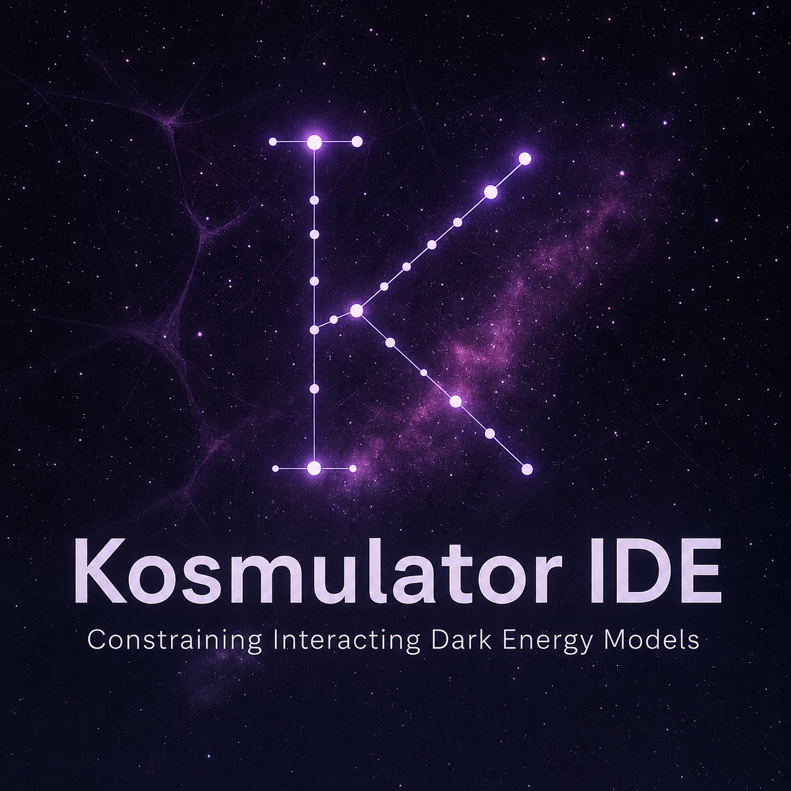

<p align="center">
  
</p>

# Kosmulator: A Python framework for cosmological inference with MCMC

Kosmulator is a Python package utilising **Zeus** and **EMCEE (The MCMC Hammer)** to perform efficient, vectorised Markov Chain Monte Carlo (MCMC) simulations for studying **modified gravity** and **alternative cosmological models**.

The package is designed to be **modular**, **flexible**, and **user-friendly**, allowing researchers to easily configure inference runs, combine multiple sets of cosmological observations, and produce high-quality statistical summaries and visualisations. A new model is written as **one Python function** for its expansion rate E(z).

**Documentation, tutorials and the full list of options: https://kosmulator.readthedocs.io**

---

## Features

- **Flexible Cosmological Inference Framework**  
  Run Bayesian inference pipelines for ΛCDM, modified gravity, and alternative cosmologies using a modular, model-agnostic architecture. A model is one E(z) function in `User_defined_modules.py`.

- **Multiple MCMC Backends**  
  Supports both **Zeus** and **EMCEE** (with differential-evolution and snooker moves), chosen per data group, with one convergence rule for both: chain length against the autocorrelation time, effective sample size and split-R̂.

- **Vectorised Likelihood Evaluation**  
  Efficient vectorised likelihood computations for fast sampling across large parameter spaces and combined datasets.

- **Wide Range of Observational Data**  
  Built-in support for 32 data sets, all included in `Observations/` (the Planck PR4 data are downloaded on first use):
  - Type Ia Supernovae (JLA, Pantheon, Pantheon+, Pantheon+SH0ES, Union3, DES-Y5)
  - Baryon Acoustic Oscillations (DESI DR1 and DR2)
  - Cosmic Chronometers / OHD
  - Growth of structure (fσ₈ and f)
  - Big Bang Nucleosynthesis (D/H with a fitted approximation or AlterBBN, and the BBN prior on Ω_b h²)
  - Cosmic Microwave Background: Planck 2018 and PR4, ACT DR6, SPT-3G D1, the P-ACT and CMB-SPA combinations, CMB lensing, and DESI DR2's compressed CMB

- **Automatic Parameter Injection & Dataset Awareness**  
  Parameters (including nuisance parameters) are automatically added or fixed based on selected observational datasets.

- **Sound Horizon (r_d) Policy Management**  
  Centralised handling of the sound horizon: fixed, free, or computed with CLASS from the model's own expansion history when BBN or the CMB calibrates it.

- **CLASS Built for You**  
  Kosmulator compiles its own **CLASS** per model from `Class/<model>`, caches the build and reuses it; no separate CLASS installation is needed.

- **Model Comparison**  
  χ², AIC, BIC, AICc, DIC and WAIC for every model and data group, differences with respect to a reference model, Δχ² as a significance, and a plain-language interpretation of each.

- **Publication-Ready Output & Visualisation**  
  Generates corner plots, best-fit theory comparisons, convergence diagnostics, LaTeX-ready statistical tables, and a list of exactly what to cite for each run.

- **Chain Reuse, Resume and Peek**  
  Reload, resume, or extend existing MCMC chains, and look at a running chain safely with `--peek`.

- **Environment Diagnostics**  
  Includes a built-in `kosmulator-doctor` command that checks the installation and, with `--setup`, builds CLASS and makes a short test run.

---

## Requirements

Kosmulator is written in Python and supports a modular backend system. Some dependencies are always required, 
while others are required only when specific observational datasets are used. The conda environment (`environment.yml`) installs all of them.

#### Core Python Dependencies (required for all runs)

- **Python 3.9 - 3.12** - Recommend Python 3.11
- **NumPy** (2.0 or newer for the Planck low-ℓ EE likelihood through clipy), **SciPy**, **Matplotlib**, **h5py**, **Pandas**
- **GetDist** (corner plots and statistical visualisation)
- **EMCEE** and **Zeus** (MCMC samplers)
- **tqdm**, **threadpoolctl**
- **Cython**, **setuptools** and a **C/C++ compiler with make**, for the CLASS builds

#### CMB-Specific Dependencies (required only when CMB likelihoods are used)

- **CLASS (classy)**: built by Kosmulator itself, per model, from `Class/<model>`.
- **clipy** (or the compiled Planck **CLIK**) for the Planck likelihoods, **candl** for ACT DR6 and SPT-3G, and **act_dr6_lenslike** for the ACT DR6 lensing likelihood. The likelihood data are in `Observations/`.

#### Optional Dependencies

- **mpi4py** and **schwimmbad** for MPI runs (`--use_mpi`, clusters).
- **AlterBBN** for live BBN predictions; Kosmulator ships an AlterBBN grid, so it is needed only beyond that grid.
- **LaTeX (TeX Live / MiKTeX)** for publication-quality plot labels (`--latex_enabled`).

---

## Installation
Kosmulator runs on Linux, macOS and Windows through WSL2. On WSL, clone it into your Linux home folder (`~/`), not into `/mnt/c` or `/mnt/d`: reading and writing files there is much slower.

The recommended route is conda ([Miniforge](https://github.com/conda-forge/miniforge)), which brings everything, including the C compiler Kosmulator uses to build CLASS, so nothing needs `sudo` (on macOS the Xcode Command Line Tools are needed as well: `xcode-select --install`):
```bash
git clone --depth 1 https://github.com/renierht/Kosmulator.git
cd Kosmulator
conda env create -f environment.yml
conda activate kosmulator
kosmulator-doctor --setup
```
`kosmulator-doctor --setup` checks the installation, builds CLASS for `LCDM_v` and `rd_Class` (a few minutes, once), loads every CMB likelihood with its data and makes a short test run. Anything missing is listed with the command that adds it. Run `kosmulator-doctor` (without `--setup`) at any time for a quick check.

<details>
<summary><b>Without conda (pip)</b></summary>

Use a clean virtual environment with Python 3.9 - 3.12 (3.11 recommended) and a C/C++ compiler (Ubuntu/WSL: `sudo apt install build-essential python3-dev python3-venv`; macOS: `xcode-select --install`):
```bash
git clone --depth 1 https://github.com/renierht/Kosmulator.git
cd Kosmulator
python3 -m venv .venv && source .venv/bin/activate
pip install -e ".[all]"
kosmulator-doctor --setup
```
`pip install -e .` installs the core only (enough for the late-time data); `".[cmb]"` adds the CMB likelihood codes (clipy, candl, act_dr6_lenslike), `".[mpi]"` adds MPI (mpi4py and schwimmbad; it needs an MPI library, e.g. `sudo apt install mpich`), and `".[all]"` both.

</details>

<details>
<summary><b>LaTeX for the plot labels (optional)</b></summary>

Kosmulator uses Matplotlib's LaTeX rendering for publication-quality labels when `--latex_enabled` is given. Check that LaTeX is available with `latex --version`.

- **Windows**: [MiKTeX](https://miktex.org/howto/install-miktex) (enable the automatic installation of missing packages)
- **macOS**: `brew install mactex`
- **Linux / WSL**: `sudo apt install texlive-latex-recommended texlive-fonts-recommended cm-super dvipng` (or `texlive-full`)

An error such as `RuntimeError: latex was not able to process the following string` usually means a LaTeX package is missing (most often `cm-super`). LaTeX rendering is optional: without it, simply leave out `--latex_enabled`.

</details>

The compiled Planck CLIK (instead of clipy) and live AlterBBN are optional extras, described in the [advanced installation](https://kosmulator.readthedocs.io/en/latest/reference/advanced_installation.html) page of the documentation.

---

## Quick Test
Run Kosmulator in your terminal.
```bash
python Kosmulator.py
```
If it ran successfully, it has been installed correctly! As shipped, `Kosmulator.py` fits ΛCDM to the cosmic chronometers, alone and with Pantheon+, in about a minute; [Your first run](https://kosmulator.readthedocs.io/en/latest/running.html#a-first-run) in the documentation goes through what it prints and writes.

## Configure Kosmulator Guide

#### Step 1: Define a New Model
Modify `User_defined_modules.py` to add your model's background expansion and register its parameters:

- Implement E(z) = H(z)/H0 for a new background model, as one function of `z` and the parameter dictionary `p`.
- Register the model name + parameter list in the model registry (`_MODEL_REGISTRY`).
- (Optionally) define additional restrictions for your model's free parameters.
- (Optionally) add a CMB helper `<model>_CMB` and a CLASS copy in `Class/<model>`, needed to fit CMB observations.

```python
def wCDM_MODEL_vectorised(z, p):
    z = _asarray(z)
    Om, w0 = float(p["Omega_m"]), float(p["w0"])
    Or = radiation_density(p)
    E2 = Om * (1 + z)**3 + Or * (1 + z)**4 + (1 - Om - Or) * (1 + z)**(3 * (1 + w0))
    return _scalar_or_array(np.sqrt(E2))

_MODEL_REGISTRY = {
    ...
    "wCDM_v": (wCDM_MODEL_vectorised, ["Omega_m", "w0"]),
}
```
The [Add your own model](https://kosmulator.readthedocs.io/en/latest/tutorials/own_model.html) tutorial goes through this example step by step.

#### Step 2: Select Datasets 
In `Kosmulator.py`, select observation datasets. Observations are specified as lists of likelihood groups; each group is fitted separately.
```python
# Run 1: DESI DR2 only | Run 2: DESI DR2 + Pantheon+ | Run 3: Joint CC, DESI DR2, Pantheon+ and BBN
observations = [ ["DESI_DR2"], ["DESI_DR2", "PantheonP"], ["CC", "DESI_DR2", "PantheonP", "BBN_DH"] ]
```

<details>
<summary><b>All data set tags</b></summary>

| Tag | Data |
|---|---|
| `JLA` | SDSS-II/SNLS3 Joint Light-curve Analysis, 740 SNe (official likelihood) |
| `JLA_legacy` | the old 359-SN file used as "JLA" before October 2026 |
| `Pantheon` | Pantheon, 1048 SNe |
| `PantheonP`, `PantheonPS` | Pantheon+ (`PantheonPS`: with the SH0ES Cepheid calibration) |
| `Union3` | Union3 / UNITY1.5 binned distance moduli |
| `DESY5` | DES-SN5YR Hubble diagram |
| `DESI_DR2` | DESI DR2 BAO, 13 measurements |
| `DESI_DR1` | DESI DR1 BAO, all 12 measurements |
| `BAO` | the 10 anisotropic DESI DR1 measurements |
| `CC` | cosmic chronometers H(z) |
| `OHD` | H(z) compilation of Sharov & Vasiliev (2018) |
| `f_sigma_8`, `f` | fσ₈(z) and the growth rate f(z) |
| `BBN_DH`, `BBN_DH_AlterBBN` | primordial D/H (PDG 2025), with a fitted approximation or AlterBBN |
| `BBN_PryMordial` | BBN prior Ω_b h² = 0.02218 ± 0.00055 |
| `ThetaStar_CMB` | DESI DR2's compressed CMB, a prior on (θ_*, ω_b, ω_bc) |
| `CMB_hil`, `CMB_hil_TT` | Planck 2018 high-ℓ TT,TE,EE and TT (plik or plik_lite) |
| `CMB_hil_PR4` | Planck PR4 high-ℓ TT,TE,EE (CamSpec; data downloaded on first use) |
| `CMB_lowl_TT`, `CMB_lowl`, `CMB_lowl_sroll2` | Planck low-ℓ TT (Commander), EE (SimAll), EE (SRoll2) |
| `CMB_lensing` | Planck 2018 lensing |
| `CMB_ACT`, `CMB_SPT`, `CMB_planck_ACTcut` | ACT DR6, SPT-3G D1, and Planck cut at the ACT multipoles |
| `CMB_PACT`, `CMB_SPA` | the P-ACT and CMB-SPA combinations |
| `CMB_lensing_ACTPlanck`, `CMB_lensing_SPT` | ACT DR6 + Planck PR4 lensing, SPT-3G MUSE lensing |

Planck's "TT,TE,EE+lowE" is `["CMB_hil", "CMB_lowl_TT", "CMB_lowl"]`. The [Data set tags](https://kosmulator.readthedocs.io/en/latest/tags.html) page of the documentation explains each, and how Kosmulator treats r_d and H_0 for each combination.

</details>

#### Step 3: Select model and configure MCMC Run
In `Kosmulator.py`, configure the MCMC sampler and specify the model names you want to analyse:

```python
# Models implemented in User_defined_modules.py
model_names: List[str] = ["Your_model_name"] 

reference_model: str = "LCDM_v"  # Against which model you want to test it

# Sampler settings
nwalkers: int = 32
nsteps: int = 5000
burn: int = 200
convergence: float = 0.05  # Stability of tau_max between checks (relative) required by the convergence rule
```
Every parameter needs a flat prior in `prior_limits` (and preferably a starting value in `reference_values`) in the same file. The other settings there (neutrinos, r_d, growth, CMB options) are explained in [Settings and command-line flags](https://kosmulator.readthedocs.io/en/latest/options.html).

#### Step 4. Execute your MCMC simulation
Run the script in the terminal:
```bash
python Kosmulator.py --output_suffix Your_Project_Name
```
The run stops by itself once the convergence rule holds (N_post ≥ 100 τ_max, ESS ≥ 2000, split-R̂ < 1.01 and a stable τ_max), or at `nsteps`. Chains go to `MCMC_Chains/<suffix>/`, plots to `Plots/Saved_Plots/<suffix>/` and statistics to `Statistical_analysis_tables/<suffix>/`.

---

## Command-Line Arguments to personalise your MCMC run
Kosmulator exposes a small set of CLI flags to control parallelism, sampler behaviour, diagnostics, and plotting.
You can view them any time with:

```bash
python Kosmulator.py --help
```

The ones used most are `--output_suffix`, `--num_cores`, `--use_mpi`, `--resume`, `--overwrite`, `--latex_enabled`, `--plot_table` and `--peek`.

<details>
<summary><b>All command-line arguments</b></summary>

#### General/ Output

| Argument | Type | Default | Description |
|---|---|---|---|
| `--output_suffix` | str | `Test_run` | Suffix for output directories and files (chains, plots, tables). |
| `--overwrite` | flag | `False` | Delete any existing `.h5` chains and run MCMC from scratch. |
| `--resume` | flag | `False` | Resume incomplete chains (instead of only loading existing results). A chain is continued only with the engine that made it. |
| `--init-log` | choice | `terse` | Initialisation logging style: `terse`, `normal`, or `verbose`. |

#### Parallelism

| Argument | Type | Default | Description |
|---|---|---|---|
| `--num_cores` | int | `8` | Number of worker processes for groups that need a pool (CMB/BBN groups, models that cannot be vectorised, official JLA). |
| `--class_threads` | int | `1` | CLASS threads per pool worker or MPI rank (a local pool has `num_cores // class_threads` workers). |
| `--use_mpi` | flag | `False` | Force use of an MPI pool (if MPI is available). |

#### Sampler / Engine Control

| Argument | Type | Default | Description |
|---|---|---|---|
| `--engine-mode` | choice | `mixed` | Sampler strategy: `mixed`, `single`, or `fastest`. |
| `--force_zeus` | flag | `False` | Force the Zeus sampler (not for groups with CMB data: they always run emcee). |
| `--force_emcee` | flag | `False` | Force the emcee sampler (ignore Zeus even if available). |
| `--force_vectorisation` | flag | `False` | Treat all models as vectorised (overrides detection). |
| `--disable_vectorisation` | flag | `False` | Disable vectorised likelihood evaluation even if available (forces scalar evaluation). |

#### Convergence / Autocorrelation  

| Argument | Type | Default | Description |
|---|---|---|---|
| `--tau-consecutive` (alias: `--consecutive-required`) | int | `1` | Number of consecutive checks at which all conditions must hold before the run stops. |
| `--autocorr-check-every` | int | `100` | Check the convergence rule (and redraw its plot) every `N` steps. |
| `--autocorr-buffer` | int | `None` | Optional minimum run length: the rule may end a run only after burn + this many steps. |

#### Plotting / Presentation

| Argument | Type | Default | Description |
|---|---|---|---|
| `--latex_enabled` | flag | `False` | Enable LaTeX rendering in plots. |
| `--plot_table` | flag | `False` | Draw the posterior summary table on the corner plot. |
| `--corner-show-all-cmb-params` | flag | `False` | Corner plot: show all CMB parameters (including nuisance). Default behaviour shows only key cosmological parameters. |
| `--corner-table-full` | flag | `False` | Corner plot top table: keep the full parameter list (including CMB nuisances). |

#### Looking at a run / Likelihood Debugging

| Argument | Type | Default | Description |
|---|---|---|---|
| `--peek` | flag | `False` | Do not run: show the run `--output_suffix` as it stands (corner plots of the chains so far, means, convergence table). Safe while the run goes on. |
| `--peek_burn` | int | run's burn-in | With `--peek`: steps to discard. |
| `--print_loglike [N]` | int (optional) | disabled | Every `N` steps, for the walker with the highest log-posterior: each data set's χ², the log prior and the total log-posterior. |

</details>

---

## Multiprocessing run examples
With MPI (recommended on clusters)
```bash
mpiexec -n <num_cores> python Kosmulator.py --use_mpi --output_suffix "Your_Project_Name" --latex_enabled --overwrite --plot_table
```
With Python multiprocessing (local / workstation)
```bash
python Kosmulator.py --num_cores <num_cores> --output_suffix "Your_Project_Name" --latex_enabled --overwrite --plot_table
```
Using nohup (run in background after closing terminal)
```bash
nohup mpiexec -n <num_cores> python Kosmulator.py --use_mpi --output_suffix "Your_Project_Name" --latex_enabled --overwrite --plot_table > kosmulator_run.log 2>&1 &
```
Continue a run that was stopped, or look at one that is still going:
```bash
python Kosmulator.py --output_suffix "Your_Project_Name" --resume
python Kosmulator.py --output_suffix "Your_Project_Name" --peek
```
[In parallel and on clusters](https://kosmulator.readthedocs.io/en/latest/running.html#in-parallel-and-on-clusters) in the documentation has a Slurm example.

---

## Project Structure

<details>
<summary><b>Folders and files</b></summary>

```plaintext
Kosmulator/
├── Kosmulator.py                # Main user-facing entry point: run settings
├── User_defined_modules.py      # User-defined cosmological and gravity models
│
├── Kosmulator_main/             # Core inference engine
│   ├── Config.py                # Dataset loading and parameter injection
│   ├── MCMC_setup.py            # High-level MCMC orchestration
│   ├── Kosmulator_MCMC.py       # Sampler execution (EMCEE / Zeus)
│   ├── Statistical_packages.py  # Likelihoods
│   ├── Post_processing.py       # Best fits and statistical summaries
│   ├── Class_run.py             # CLASS integration and caching
│   ├── rd_helpers.py, rd_class.py   # Sound-horizon (r_d) handling
│   ├── planck_pr4.py, ground_cmb.py, cmb_early.py, theta_mc.py   # CMB likelihoods and helpers
│   ├── peek.py, citations.py, doctor.py, get_spt_data.py         # Tools
│   ├── constants.py             # Global constants and runtime policies
│   └── utils.py                 # Shared utilities and CLI helpers
│
├── Class/                       # CLASS sources, one copy per model (LCDM_v, wowaCDM_v, f1CDM_v)
├── AlterBBN_files/              # AlterBBN interface (optional)
├── Observations/                # Observational datasets and likelihood files (DATA_SOURCES.md)
├── Plots/                       # Plotting; results in Plots/Saved_Plots/
├── MCMC_Chains/                 # Stored MCMC chains
├── Statistical_analysis_tables/ # Statistical summaries, LaTeX-ready tables and citations
│
├── docs/                        # Documentation (kosmulator.readthedocs.io; Sphinx)
├── environment.yml              # conda environment
├── setup.py, pyproject.toml     # Packaging and installation
├── LICENSE, LICENSES/           # MIT; LGPL-3.0 and GPL-3.0 texts for planck_pr4.py
└── README.md
```

</details>

---

## References
**NB!** Remember to cite the observation’s **original papers** when using their data in Kosmulator.

- Every run writes `Statistical_analysis_tables/<output_suffix>/citations.md`: what to cite for exactly the data sets, samplers and codes that run used, with their BibTeX in `citations.bib` next to it.
- `Observations/DATA_SOURCES.md` lists every data set Kosmulator includes: its files, where they come from, the licence status of the source, the papers to cite and the acknowledgements a data licence asks for (DESI's). `Observations/references.bib` holds their BibTeX.

<details>
<summary><b>Original MCMC code which developed into Kosmulator</b></summary>

1. **Original Kosmulator implementation**  
   Hough, R. T., Abebe, A., & Ferreira, S. E. S. (2020).  
   *Viability tests of f(R)-gravity models with Supernovae Type Ia data*.  
   European Physical Journal C, 80(8), 787.  
   https://doi.org/10.1140/epjc/s10052-020-8342-7

</details>

<details>
<summary><b>MCMC Samplers</b></summary>

1. **EMCEE**  
   Foreman-Mackey, D., Hogg, D. W., Lang, D., et al. (2013).  
   *emcee: The MCMC Hammer*.  
   PASP, 125(925), 306.  
   https://doi.org/10.1086/670067

2. **Zeus**  
   Karamanis, M., Beutler, F., Peacock, J. A.,(2021).  
   *zeus: A Python implementation of Ensemble Slice Sampling for efficient Bayesian parameter inference*.  
   MNRAS, 508(3), 3589 (arXiv:2105.03468).  
   https://doi.org/10.1093/mnras/stab2867

3. **Ensemble Slice Sampling** (zeus's method)  
   Karamanis, M., & Beutler, F. (2021).  
   *Ensemble Slice Sampling: Parallel, black-box and gradient-free inference for correlated & multimodal distributions*.  
   Statistics and Computing, 31, 61 (arXiv:2002.06212).  
   https://doi.org/10.1007/s11222-021-10038-2

4. **DE + snooker moves** (`emcee_moves = "de_snooker"`)  
   ter Braak, C. J. F. (2006). *A Markov Chain Monte Carlo version of the genetic algorithm Differential Evolution: easy Bayesian computing for real parameter spaces*. Statistics and Computing, 16, 239.  
   https://doi.org/10.1007/s11222-006-8769-1  
   ter Braak, C. J. F., & Vrugt, J. A. (2008). *Differential Evolution Markov Chain with snooker updater and fewer chains*. Statistics and Computing, 18, 435.  
   https://doi.org/10.1007/s11222-008-9104-9

</details>

<details>
<summary><b>Codes Kosmulator uses</b></summary>

1. **CLASS** (CMB spectra, r_d)  
   Lesgourgues, J. (2011). *The Cosmic Linear Anisotropy Solving System (CLASS) I: Overview*. arXiv:1104.2932.  
   Blas, D., Lesgourgues, J., & Tram, T. (2011). *The Cosmic Linear Anisotropy Solving System (CLASS) II: Approximation schemes*. JCAP, 07, 034 (arXiv:1104.2933).  
   https://doi.org/10.1088/1475-7516/2011/07/034

2. **HMcode-2020** (`cmb_nonlinear = "hmcode"`)  
   Mead, A., Brieden, S., Tröster, T., & Heymans, C. (2021). *HMcode-2020: Improved modelling of non-linear cosmological power spectra with baryonic feedback*. MNRAS, 502, 1401 (arXiv:2009.01858).  
   https://doi.org/10.1093/mnras/stab082  
   HMcode 2015 (`hmcode_version = "2015"`): Mead, A., Peacock, J., Heymans, C., Joudaki, S., & Heavens, A. (2015). *An accurate halo model for fitting non-linear cosmological power spectra and baryonic feedback models*. MNRAS, 454, 1958 (arXiv:1505.07833).  
   https://doi.org/10.1093/mnras/stv2036  
   Halofit (`cmb_nonlinear = "halofit"`): Takahashi, R., et al. (2012). *Revising the Halofit Model for the Nonlinear Matter Power Spectrum*. ApJ, 761, 152 (arXiv:1208.2701).  
   https://doi.org/10.1088/0004-637X/761/2/152

3. **candl** (ACT and SPT likelihoods)  
   Balkenhol, L., Trendafilova, C., Benabed, K., & Galli, S. (2024). *candl: Cosmic Microwave Background Analysis with a Differentiable Likelihood*. A&A, 686, A10 (arXiv:2401.13433).  
   https://doi.org/10.1051/0004-6361/202449432

4. **AlterBBN** (`BBN_DH_AlterBBN`)  
   Arbey, A. (2012). *AlterBBN: A program for calculating the BBN abundances of the elements in alternative cosmologies*. Comput. Phys. Commun., 183, 1822 (arXiv:1106.1363).  
   https://doi.org/10.1016/j.cpc.2012.03.018  
   Arbey, A., Auffinger, J., Hickerson, K. P., & Jenssen, E. S. (2020). *AlterBBN v2*. Comput. Phys. Commun., 248, 106982 (arXiv:1806.11095).  
   https://doi.org/10.1016/j.cpc.2019.106982

5. **GetDist** (corner plots)  
   Lewis, A. (2025). *GetDist: a Python package for analysing Monte Carlo samples*. JCAP, 08, 025 (arXiv:1910.13970).  
   https://doi.org/10.1088/1475-7516/2025/08/025

6. **r_d without CLASS** (BAO with BBN or primary CMB, when CLASS cannot be imported)  
   Eisenstein, D. J., & Hu, W. (1998). *Baryonic Features in the Matter Transfer Function*. ApJ, 496, 605 (arXiv:astro-ph/9709112).  
   https://doi.org/10.1086/305424

7. **Cobaya** (the CamSpec PR4 likelihood, `CMB_hil_PR4`, is derived from its Python CamSpec code; see Licence)  
   Torrado, J., & Lewis, A. (2021). *Cobaya: Code for Bayesian Analysis of hierarchical physical models*. JCAP, 05, 057 (arXiv:2005.05290).  
   https://doi.org/10.1088/1475-7516/2021/05/057

8. **CAMB** (z_* and r_s(z_*) of the `ThetaStar_CMB` grid)  
   Lewis, A., Challinor, A., & Lasenby, A. (2000). *Efficient Computation of CMB anisotropies in closed FRW models*. ApJ, 538, 473 (arXiv:astro-ph/9911177).  
   https://doi.org/10.1086/309179

9. **100 θ_MC** (`cmb_sample_theta`: CosmoMC's approximation, which takes z_* from the fit of)  
   Hu, W., & Sugiyama, N. (1996). *Small-Scale Cosmological Perturbations: an Analytic Approach*. ApJ, 471, 542 (arXiv:astro-ph/9510117).  
   https://doi.org/10.1086/177989

</details>

<details>
<summary><b>Type Ia Supernovae</b></summary>

#### JLA
1. Betoule, M., et al. (2014).  
   *Improved cosmological constraints from a joint analysis of the SDSS-II and SNLS supernova samples*.  
   A&A, 568, A22.  
   https://doi.org/10.1051/0004-6361/201423413 (arXiv:1401.4064)  
   Data files: CosmoMC/Cobaya distribution, https://github.com/CobayaSampler/sn_data

#### JLA_legacy (old 359-SN file, taken from the papers below)
1. Hicken, M., Challis, P., Jha, S., et al. (2009).  
   *CfA3: 185 Type Ia Supernova Light Curves from the CfA*.  
   ApJ, 700, 331.  
   https://doi.org/10.1088/0004-637X/700/1/331

2. Neill, J. D., Sullivan, M., Howell, D. A., et al. (2009).  
   *The Local Hosts of Type Ia Supernovae*.  
   ApJ, 707, 1449.  
   https://doi.org/10.1088/0004-637X/707/2/1449

3. Conley, A., Guy, J., Sullivan, M., et al. (2011).  
   *Supernova Constraints and Systematic Uncertainties from the First Three Years of the SNLS*.  
   ApJS, 192, 1.  
   https://doi.org/10.1088/0067-0049/192/1/1

#### Pantheon
`Observations/Pantheon.dat` has the release's distances and their statistical errors only, as in the
paper's statistical-only analysis (flat LCDM, Pantheon alone: Omega_m = 0.284 +- 0.012). With
`PANTHEON_SYS_COV = "full"` in `Kosmulator_main/constants.py` (default None) the release's systematic
covariance (`Observations/Pantheon_release/sys_full_long.txt`) is added, as in the published analysis
(Omega_m = 0.298 +- 0.022, Scolnic et al. 2018, Sect. 6.1). The error bars in `bestfit.png` are then the
square roots of the covariance's diagonal (on average 0.3% larger than the statistical errors; the
systematics act mainly through the correlations, which error bars cannot show). The same holds for every
data set used with a covariance (CC with `CC_SYS_COV`, DES-Y5, Union3, the WiggleZ rows of f_sigma_8).

1. Scolnic, D. M., Jones, D. O., Rest, A., et al. (2018).  
   *The Complete Light-curve Sample of Spectroscopically Confirmed SNe Ia from Pan-STARRS1 and Cosmological Constraints from the Combined Pantheon Sample*.  
   ApJ, 859(2), 101.  
   https://doi.org/10.3847/1538-4357/aab9bb

#### Pantheon+
1. Brout, D., Scolnic, D., Popovic, B., et al. (2022).  
   *The Pantheon+ Analysis: Cosmological Constraints*.  
   ApJ, 938(2), 110.  
   https://doi.org/10.3847/1538-4357/ac8e04

2. Scolnic, D., et al. (2022).  
   *The Pantheon+ Analysis: The Full Data Set and Light-curve Release*.  
   ApJ, 938(2), 113 (arXiv:2112.03863).  
   https://doi.org/10.3847/1538-4357/ac8b7a

3. With the SH0ES calibration (`PantheonPS`): Riess, A. G., et al. (2022).  
   *A Comprehensive Measurement of the Local Value of the Hubble Constant with 1 km/s/Mpc Uncertainty from the Hubble Space Telescope and the SH0ES Team*.  
   ApJL, 934(1), L7 (arXiv:2112.04510).  
   https://doi.org/10.3847/2041-8213/ac5c5b

#### Union3
1. Rubin, D., Aldering, G., Betoule, M., et al. (2025).  
   *Union through UNITY: Cosmology with 2000 SNe Using a Unified Bayesian Framework*.  
   ApJ, 986(2), 231.  
   https://doi.org/10.3847/1538-4357/adc0a5

#### DESY5
1. DES Collaboration; Abbott, T. M. C., et al. (2024).  
   *The Dark Energy Survey: Cosmology Results with ~1500 New High-redshift Type Ia Supernovae Using the Full 5 yr Data Set*.  
   ApJL, 973(1), L14.  
   https://doi.org/10.3847/2041-8213/ad6f9f

2. Sánchez, B. O., et al. (2024).  
   *The Dark Energy Survey Supernova Program: Light Curves and 5 Yr Data Release*.  
   ApJ, 975(1), 5 (arXiv:2406.05046).  
   https://doi.org/10.3847/1538-4357/ad739a

</details>

<details>
<summary><b>Expansion Rate Measurements</b></summary>

#### Cosmic Chronometers (CC)
`Observations/CC.dat` lists the source paper of every point after a `#`. Each row was checked
against its paper; where a paper gives statistical and systematic errors separately they are
combined in quadrature. The three DESI points of Loubser (2025) are correlated, and the
correlations are read from `Observations/CC_corr.txt` and used in the CC chi^2. The SPS-model
systematic covariance of the D4000 points (Moresco et al. 2020) is added with `CC_SYS_COV = "full"`
(or `"ooo"`) in `Kosmulator_main/constants.py`; by default (None) it is not included.

1. Moresco, M., Jimenez, R., Verde, L., et al. (2020).  
   *Setting the Stage for Cosmic Chronometers II*.  
   ApJ, 898(1), 82.  
   https://doi.org/10.3847/1538-4357/ab9eb0
   
2. Qi, J.-Z., Meng, P., Zhang, J.-F., & Zhang, X. (2023).  
   *Model-independent measurement of cosmic curvature with the latest H(z) and SNe Ia data: A comprehensive investigation*.  
   Phys. Rev. D, 108(6), 063522.  
   https://doi.org/10.1103/PhysRevD.108.063522
   
3. Loubser, S. I., Alabi, A. B., Hilton, M., Ma, Y.-Z., Tang, X., Hatamkhani, N.,  
   Cress, C., Skelton, R. E., & Nkosi, S. A. (2025).  
   *An independent estimate of H(z) at z = 0.5 from the stellar ages of brightest cluster galaxies*.  
   Monthly Notices of the Royal Astronomical Society, **540**(4), 3135–3149.  
   https://doi.org/10.1093/mnras/staf915
   
4. Loubser, S. I. (2025).  
   *Measuring the expansion history of the Universe with DESI cosmic chronometers*.  
   Monthly Notices of the Royal Astronomical Society, **544**(4), 3064–3075.  
   https://doi.org/10.1093/mnras/staf1939
   
5. Wang, Z.-F., Lei, L., & Fan, Y.-Z. (2026).  
   *New H(z) measurement at redshift z = 0.12 with DESI Data Release 1*.  
   arXiv:2601.07345.  
   https://doi.org/10.48550/arXiv.2601.07345

#### Observational Hubble Data (OHD)
Note: This is a compilation paper of all the individual data-point. Also cite the original papers. Citations can be found in this paper.
1. Sharov, G. S., & Vasiliev, V. O. (2018).  
   *How predictions of cosmological models depend on Hubble parameter data sets*.  
   Mathematical Modelling and Geometry, 6(1), 1 (arXiv:1807.07323).  
   https://doi.org/10.26456/mmg/2018-611

</details>

<details>
<summary><b>Large-Scale Structure</b></summary>

#### Baryon Acoustic Oscillations (BAO) / DESI
1. Adame, A. G., Aguilar, J., Ahlen, S., et al. (2024).  
   *DESI 2024 VI: Cosmological constraints from the measurements of baryon acoustic oscillations*.  
   JCAP, 02, 021 (2025) (arXiv:2404.03002).  
   https://doi.org/10.1088/1475-7516/2025/02/021

2. Lodha, K., Shafieloo, A., Calderon, R., et al. (DESI Collaboration) (2025).  
   *DESI 2024: Constraints on physics-focused aspects of dark energy using DESI DR1 BAO data*.  
   Phys. Rev. D, 111(2), 023532.  
   https://doi.org/10.1103/PhysRevD.111.023532

3. Abdul Karim, M., Aguilar, J., Ahlen, S., et al. (DESI Collaboration) (2025).  
   *DESI DR2 results. II. Measurements of baryon acoustic oscillations and cosmological constraints*.  
   Phys. Rev. D, 112(8), 083515.  
   https://doi.org/10.1103/tr6y-kpc6  

4. DESI Collaboration, Abdul Karim, M., et al. (2026).  
   *Data Release 1 of the Dark Energy Spectroscopic Instrument*.  
   AJ, 171, 285 (arXiv:2503.14745).  
   https://doi.org/10.3847/1538-3881/ae4c43  
   DESI's data licence (CC BY 4.0) asks publications using DESI data to cite the data release paper and include DESI's acknowledgement text: https://data.desi.lbl.gov/doc/acknowledgments/

#### Growth of Structure (fσ₈)
`Observations/f_sigma_8.dat` is Table VI of Skara & Perivolaropoulos (2020), an update of the Kazantzidis & Perivolaropoulos (2018) compilation; also cite the survey papers of the points.

1. Kazantzidis, L., & Perivolaropoulos, L. (2018).  
   *Evolution of the fσ8 tension with the Planck15/ΛCDM determination and implications for modified gravity theories*.  
   Phys. Rev. D, 97(10), 103503.  
   https://doi.org/10.1103/PhysRevD.97.103503

2. Skara, F., & Perivolaropoulos, L. (2020).  
   *Tension of the E_G statistic and RSD data with Planck/ΛCDM and implications for weakening gravity*.  
   Phys. Rev. D, 101(6), 063521 (arXiv:1911.10609).  
   https://doi.org/10.1103/PhysRevD.101.063521

#### Growth rate f(z)
Growth rate f(z) (`f`, `Observations/f.dat`): rows 1 - 3 from Perenon et al. (2019), rows 4 - 14 from Table 1 of Avila et al. (2022).

1. Perenon, L., Bel, J., Maartens, R., et al. (2019).  
   *Optimising Growth of Structure Constraints on Modified Gravity*.  
   JCAP, 2019(06), 020.  
   https://doi.org/10.1088/1475-7516/2019/06/020

2. Avila, F., Bernui, A., Bonilla, A., & Nunes, R. C. (2022).  
   *Inferring S₈(z) and γ(z) with cosmic growth rate measurements using machine learning*.  
   Eur. Phys. J. C, 82, 594 (arXiv:2201.07829).  
   https://doi.org/10.1140/epjc/s10052-022-10561-0

</details>

<details>
<summary><b>Early-time observations</b></summary>

#### Cosmic Microwave Background (CMB, Planck)

Kosmulator uses the standard **Planck likelihood datasets** distributed by the
**European Space Agency (ESA)** and accessed via the Planck **CLIK** likelihood
library.

1. Planck Collaboration (2018).  
   *Planck 2018 results. VI. Cosmological parameters*.  
   Astronomy & Astrophysics, **641**, A6.  
   https://doi.org/10.1051/0004-6361/201833910

2. Planck Collaboration (2020).  
   *Planck 2018 results. V. CMB power spectra and likelihoods* (plik, plik_lite, Commander, SimAll).  
   Astronomy & Astrophysics, **641**, A5 (arXiv:1907.12875).  
   https://doi.org/10.1051/0004-6361/201936386

3. Planck Collaboration (2020).  
   *Planck 2018 results. VIII. Gravitational lensing* (`CMB_lensing`).  
   Astronomy & Astrophysics, **641**, A8 (arXiv:1807.06210).  
   https://doi.org/10.1051/0004-6361/201833886

4. SRoll2 low-ℓ EE (`CMB_lowl_sroll2`): Pagano, L., et al. (2020).  
   *Reionization optical depth determination from Planck HFI data with ten percent accuracy*.  
   A&A, **635**, A99 (arXiv:1908.09856).  
   https://doi.org/10.1051/0004-6361/201936630

5. Planck PR4 CamSpec (`CMB_hil_PR4`): Rosenberg, E., Gratton, S., & Efstathiou, G. (2022).  
   *CMB power spectra and cosmological parameters from Planck PR4 with CamSpec*.  
   MNRAS, **517**, 4620 (arXiv:2205.10869).  
   https://doi.org/10.1093/mnras/stac2744  
   The PR4 (NPIPE) maps: Planck Collaboration (2020). *Planck intermediate results. LVII. Joint Planck LFI and HFI data processing*. A&A, **643**, A42 (arXiv:2007.04997).  
   https://doi.org/10.1051/0004-6361/202038073

6. Compressed CMB prior (`ThetaStar_CMB`): DESI Collaboration (2025), DESI DR2 Results II, Appendix A (arXiv:2503.14738), from the chains of Lemos, P., & Lewis, A. (2023).  
   *CMB constraints on the early Universe independent of late-time cosmology*.  
   Phys. Rev. D, **107**, 103505 (arXiv:2302.12911).  
   https://doi.org/10.1103/PhysRevD.107.103505

#### Ground-based CMB (ACT DR6, SPT-3G D1) and the P-ACT / CMB-SPA combinations
`CMB_PACT` and `CMB_SPA` combine the Planck parts above with these.

1. ACT DR6 (`CMB_ACT`): Louis, T., et al. (2025). *The Atacama Cosmology Telescope: DR6 Power Spectra, Likelihoods and ΛCDM Parameters*. JCAP, 11, 062 (arXiv:2503.14452), https://doi.org/10.1088/1475-7516/2025/11/062; Calabrese, E., et al. (2025). *DR6 Constraints on Extended Cosmological Models*. JCAP, 11, 063 (arXiv:2503.14454), https://doi.org/10.1088/1475-7516/2025/11/063; Naess, S., et al. (2025). *DR6 Maps*. JCAP, 11, 061 (arXiv:2503.14451), https://doi.org/10.1088/1475-7516/2025/11/061

2. SPT-3G D1 (`CMB_SPT`): Camphuis, E., et al. (2026). *SPT-3G D1: CMB temperature and polarization power spectra and cosmology from 2019 and 2020 observations of the SPT-3G Main field* (the SPT-lite likelihood is its Appendix F). Phys. Rev. D, 113, 083504 (arXiv:2506.20707), https://doi.org/10.1103/7wt3-9v2y; Balkenhol, L. (2025). *Compressed 'CMB-lite' Likelihoods Using Automatic Differentiation*. Open J. Astrophys. (arXiv:2412.00826), https://doi.org/10.33232/001c.129886; Quan, W., et al. (2026). *SPT-3G D1: Maps of the millimeter-wave sky* (arXiv:2603.20163)

#### CMB lensing beyond Planck 2018
1. ACT DR6 + Planck PR4 (`CMB_lensing_ACTPlanck`): Qu, F. J., et al. (2024). ApJ, 962, 112 (arXiv:2304.05202), https://doi.org/10.3847/1538-4357/acfe06; Madhavacheril, M. S., et al. (2024). ApJ, 962, 113 (arXiv:2304.05203), https://doi.org/10.3847/1538-4357/acff5f; Carron, J., Mirmelstein, M., & Lewis, A. (2022). *CMB lensing from Planck PR4 maps*. JCAP, 09, 039 (arXiv:2206.07773), https://doi.org/10.1088/1475-7516/2022/09/039

2. SPT-3G MUSE (`CMB_lensing_SPT`): Ge, F., et al. (2025). *Cosmology From CMB Lensing and Delensed EE Power Spectra Using 2019-2020 SPT-3G Polarization Data*. Phys. Rev. D, 111, 083534 (arXiv:2411.06000), https://doi.org/10.1103/PhysRevD.111.083534

#### Big Bang Nucleosynthesis (BBN)
`BBN_DH` uses the 12 quasar D/H systems of the PDG 2025 BBN review (weighted mean
25.08 ± 0.29 × 10⁻⁶, scale factor 1.08; values in `constants.BBN_DH_PDG_SYSTEMS`). Without
AlterBBN the predicted D/H(ω_b) is a power law fitted to the PRyMordial table
(D/H = 2.508 × 10⁻⁵ (ω_b/0.0224)^−1.640). Every backend adds a 4.1% theory error
(nuclear rates), common to all systems.

1. Cooke, R. J., Pettini, M., Jorgenson, R. A., Murphy, M. T., & Steidel, C. C. (2014).  
   *Precision Measures of the Primordial Abundance of Deuterium*.  
   The Astrophysical Journal, **781**(1), 31.  
   https://doi.org/10.1088/0004-637X/781/1/31

2. Fields, B. D., Molaro, P., & Sarkar, S. (2025).  
   *Big-Bang Nucleosynthesis*, in the Review of Particle Physics (Particle Data Group), 2025 update.  
   https://pdg.lbl.gov  
   PDG's own citation for the Review: S. Navas et al. (Particle Data Group), Phys. Rev. D 110, 030001 (2024) and 2025 update, https://doi.org/10.1103/PhysRevD.110.030001

3. The BBN prior (`BBN_PryMordial`, Ω_b h² = 0.02218 ± 0.00055): Schöneberg, N. (2024).  
   *The 2024 BBN baryon abundance update*.  
   JCAP, 06, 006 (arXiv:2401.15054).  
   https://doi.org/10.1088/1475-7516/2024/06/006

4. Burns, A.-K., Tait, T. M. P., & Valli, M. (2024).  
   *PRyMordial: the first three minutes, within and beyond the standard model*.  
   Eur. Phys. J. C, 84, 86 (arXiv:2307.07061).  
   https://doi.org/10.1140/epjc/s10052-024-12442-0

</details>

---

## Citation

Kosmulator is an actively developed research framework.
If you use Kosmulator in your work, please cite the dedicated software paper:

```bibtex
@ARTICLE{2026arXiv260208424H,
       author = {{Hough}, Renier T. and {Rugg}, Robert and {Sahlu}, Shambel and {Abebe}, Amare},
        title = "{Kosmulator: A Python framework for cosmological inference with MCMC}",
      journal = {arXiv e-prints},
     keywords = {Cosmology and Nongalactic Astrophysics, General Relativity and Quantum Cosmology},
         year = 2026,
        month = feb,
          eid = {arXiv:2602.08424},
        pages = {arXiv:2602.08424},
          doi = {10.48550/arXiv.2602.08424},
archivePrefix = {arXiv},
       eprint = {2602.08424},
 primaryClass = {astro-ph.CO},
       adsurl = {https://ui.adsabs.harvard.edu/abs/2026arXiv260208424H},
      adsnote = {Provided by the SAO/NASA Astrophysics Data System}
}
```

Additionally, please cite the original paper detailing the initial implementation of the code:
```bibtex
@ARTICLE{2020EPJC...80..787H,
       author = {{Hough}, R.~T. and {Abebe}, A. and {Ferreira}, S.~E.~S.},
        title = "{Viability tests of f(R)-gravity models with Supernovae Type 1A data}",
      journal = {European Physical Journal C},
     keywords = {General Relativity and Quantum Cosmology, Astrophysics - Cosmology and Nongalactic Astrophysics},
         year = 2020,
        month = aug,
       volume = {80},
       number = {8},
          eid = {787},
        pages = {787},
          doi = {10.1140/epjc/s10052-020-8342-7},
archivePrefix = {arXiv},
       eprint = {1911.05983},
 primaryClass = {gr-qc},
       adsurl = {https://ui.adsabs.harvard.edu/abs/2020EPJC...80..787H},
      adsnote = {Provided by the SAO/NASA Astrophysics Data System}
}
```

## Licence
Kosmulator is released under the MIT licence (`LICENSE`), except `Kosmulator_main/planck_pr4.py` (the Planck PR4
CamSpec likelihood, `CMB_hil_PR4`). That file is derived from Cobaya's Python CamSpec code (copyright Jesus Torrado
and Antony Lewis) and is therefore under the GNU Lesser General Public License, version 3 or later, as Cobaya is
(texts in `LICENSES/`). Cobaya's licence also asks that publications using results of the code are submitted to
arXiv no later than to a journal, and that bugs are reported. Kosmulator does not need Cobaya to run.

## Contributions
Contributions are welcome.

If you would like to contribute, please fork the repository and submit a pull request.
Bug fixes, documentation improvements, new observational datasets, and extensions to cosmological or modified-gravity models are encouraged.

If you prefer, you may also contact the author directly with tested code or proposed improvements for inclusion in the main repository.

## Contact
For questions or feedback, please contact:

- Renier Hough - [25026097@mynwu.ac.za] - Main contributor

- Robert Rugg - [31770312@mynwu.ac.za] for help with CLIK, CLASS and the CMB observations.

- Shambel Sahlu - [shambel.sahlu@nithecs.ac.za] for help with the observations and the physics models which were included.

## Acknowledgements
I would like to thank the **EMCEE: Hammer** and **Zeus-MCMC** groups for making their MCMC simulation software publically available. This code would not be possible without their hard work. 
I would also like to thank the **ChatGPT** and **Gemini** AI software for assisting with debugging, improving the code structure, and optimizing features.
