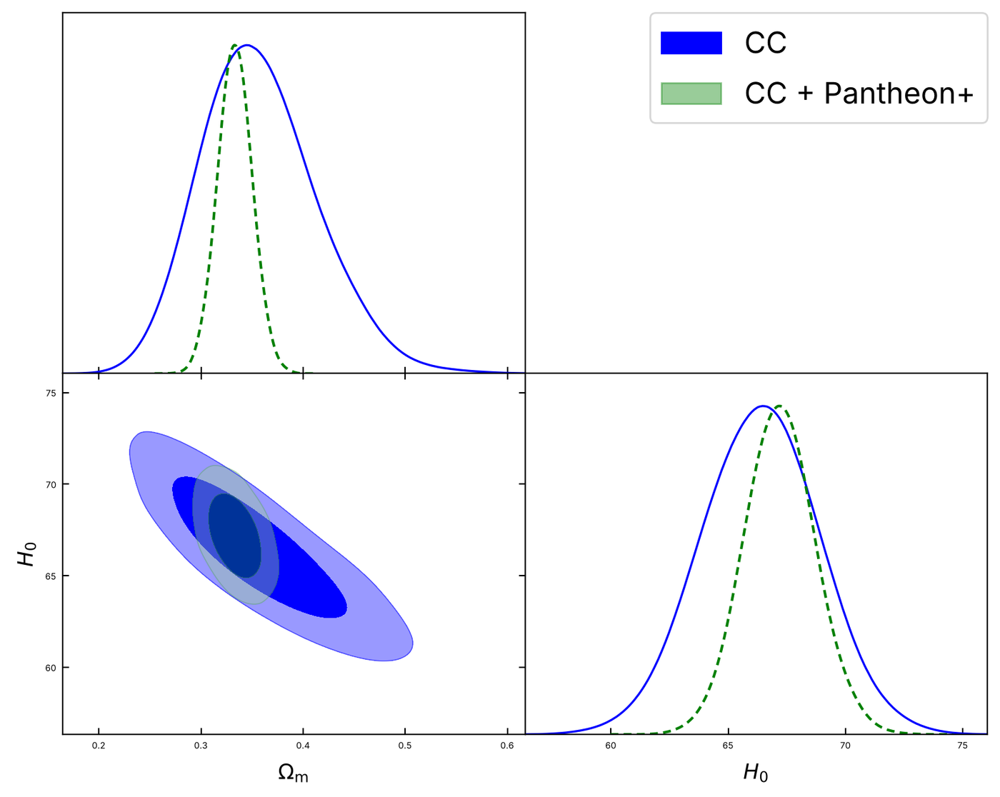
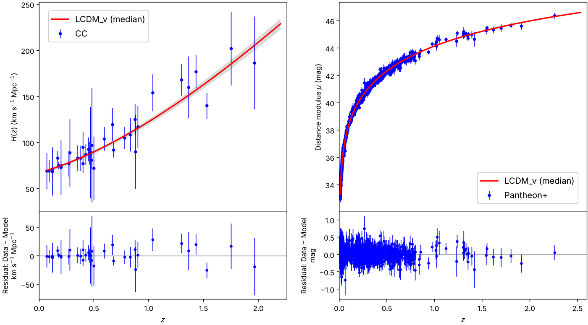
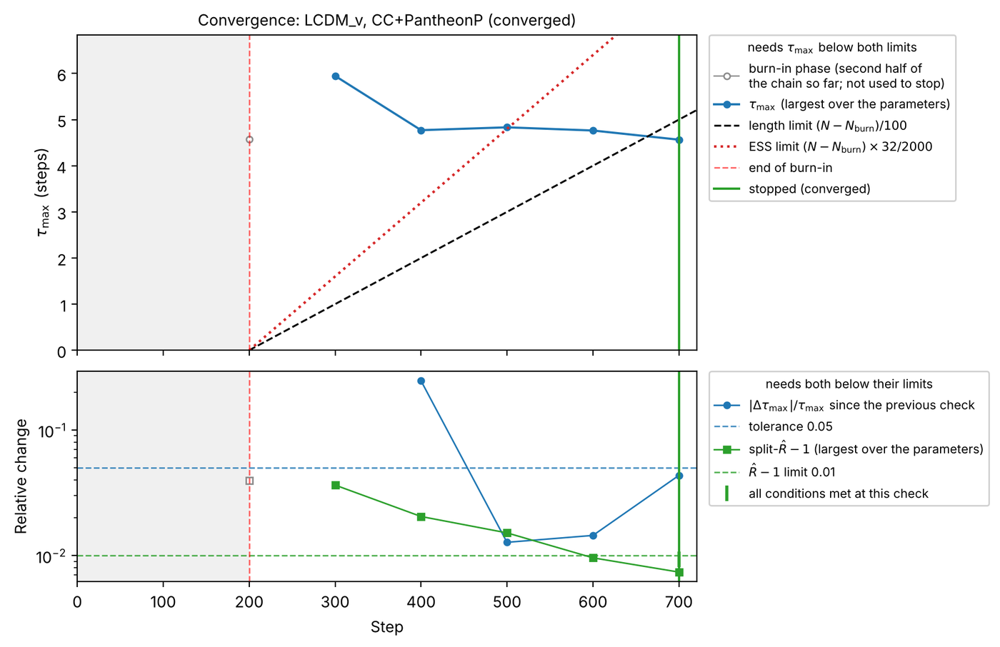

# Running Kosmulator

A run is set up in **`Kosmulator.py`** (which models, which data, which priors and sampler settings) and started from the command line (how: the name of the run, the number of cores, resuming, plotting). This page starts with a quick test and a complete first run, then goes through the settings in `Kosmulator.py`, the command line, runs on clusters, and resuming.

## Quick test

From the Kosmulator folder, with the environment active:

```bash
python Kosmulator.py
```

If it runs to the end, Kosmulator is installed correctly. With the settings `Kosmulator.py` ships with, this is the first run described next: ΛCDM fitted to the cosmic chronometers, alone and with Pantheon+, in about a minute.

## A first run

The settings `Kosmulator.py` ships with fit flat ΛCDM to the cosmic chronometers, alone and together with the Pantheon+ supernovae. This section shows what they mean, and what Kosmulator prints and writes. It takes about a minute on a laptop.

### 1. The model and the data

Open `Kosmulator.py`. Everything you set for a run is in the block headed *User configuration*. As shipped, it has:

```python
# Models implemented in User_defined_modules.py
model_names: List[str] = ["LCDM_v"]

# Each inner list is a combined likelihood
observations: List[List[str]] = [
    ["CC"],
    ["CC", "PantheonP"],
]

reference_model: str = "LCDM_v"

# Sampler settings
nwalkers: int = 32
nsteps: int = 5000
burn: int = 200
convergence: float = 0.05
```

Each inner list of `observations` is one **group**: its data sets are combined into one likelihood and fitted together. This run therefore makes two fits, `CC` and `CC+PantheonP`. The other settings in the block (priors, physics switches) can stay as they are; [Configuring a run](#configuring-a-run) explains them.

### 2. Run

```bash
python Kosmulator.py --output_suffix First_run
```

`--output_suffix` names the run: its chains, plots and tables go to subfolders with this name, so different runs never overwrite each other.

### 3. What Kosmulator prints

Kosmulator first says what it will do. Parameters needed by the data are added to the model's own (here $H_0$), and the model is checked for vectorisation, which decides the sampler:

```text
INFO | Models (ordered): ['LCDM_v']
INFO | Observations: [['CC'], ['CC', 'PantheonP']]
INFO | Sampler: nwalkers=32 nsteps=5000 burn=200 conv=0.05000
INFO | Parameter injections (identical for all models; added automatically from dataset requirements)
WARNING |   ['CC']               → H_0
WARNING |   ['CC', 'PantheonP']  → H_0
INFO | Model 'LCDM_v' vectorised: True
INFO |   Model 'LCDM_v': engine zeus (vectorised=True, touches CMB/BBN=False)
```

Each group is then fitted. Kosmulator finds a good starting point with a short optimisation, starts the walkers around it and samples until the convergence rule holds:

```text
Observations:             CC data (aka CC data)
Observations:             Pantheon+ data (aka SNe data)
SciPy optimized IC: [ 0.33299899 67.19221168]
INFO | Initialising ensemble of 32 walkers...
INFO | [LCDM_v | CC+PantheonP] zeus converged, stopped at step 700: tau_max = 4.6 (Omega_m), N_post/tau = 110 (needs >= 100: ok); ESS = 3504 (needs >= 2000: ok); tau_max change since the previous check = 4.4% (needs < 5%: ok); split-Rhat = 1.0074 (H_0) (needs < 1.01: ok).
INFO | [LCDM_v | CC+PantheonP] zeus sampling took 43 seconds
```

`nsteps` is therefore a maximum, not the length of the run: this group stopped after 700 of the 5000 steps. Finally the plots and the statistics are made, and the parameter table and the statistics are printed:

```text
Model: LCDM_v, parameters (median and 68% interval):
Parameter | CC                        | CC+Pantheon+
----------------------------------------------------
Omega_m   | $0.353^{+0.061}_{-0.052}$ | $0.333^{+0.017}_{-0.017}$
H_0       | $66.4^{+2.5}_{-2.6}$      | $67.2^{+1.5}_{-1.5}$
```

### 4. What Kosmulator writes

```text
MCMC_Chains/First_run/                          the chains (HDF5)
Plots/Saved_Plots/First_run/LCDM_v/
├── corner_plots/corner_LCDM_v.png
├── best_fits/CC/bestfit.png
├── best_fits/CC_PantheonP/bestfit.png
├── auto_corr/CC.png
└── auto_corr/CC_PantheonP.png
Statistical_analysis_tables/First_run/
├── citations.md, citations.bib
└── LCDM_v/stats_summary.txt, interpretations_summary.txt, convergence_summary.txt, aligned_table_pretty.txt
```

The **corner plot** compares the groups of a model: here the supernovae fix the shape of $H(z)$, and with it $\Omega_m$, much better than the chronometers alone.



The **best-fit plot** shows each data set of a group with the model at the posterior medians, its 68% band, and the residuals.



The **convergence plot** shows the quantities of the convergence rule at every check, against their limits; the run stopped at the first check where all of them held.



[Outputs and statistics](outputs.md) describes every file. Plots with LaTeX labels need `--latex_enabled` (and LaTeX installed).

## Configuring a run

Everything about a run is set in **`Kosmulator.py`**, in the block headed *User configuration*. Models live in `User_defined_modules.py` (see [Add your own model](tutorials/own_model.md)); the settings below decide which models are fitted to which data, with which priors and sampler settings.

### Models and the reference model

```python
model_names: List[str] = ["wowaCDM_v", "f1CDM_v"]
reference_model: str = "LCDM_v"
```

`model_names` lists the models to fit, by the names they have in the model registry of `User_defined_modules.py`. Kosmulator always fits the `reference_model` as well (first), and every statistic of the other models is also given as a difference with respect to it ($\Delta\chi^2$, $\Delta$AIC, $\Delta$BIC, ...). Negative differences favour your model.

The models shipped with Kosmulator are:

| Name | Model | Free parameters |
|---|---|---|
| `LCDM_v` | flat ΛCDM | `Omega_m` |
| `wowaCDM_v` | flat $w_0w_a$CDM (CPL dark energy) | `Omega_m`, `w0`, `wa` |
| `f1CDM_v` | power-law $f(T)$ gravity | `Omega_m`, `n` |
| `LCDM_nv`, `f1CDM_nv` | the same as `LCDM_v` and `f1CDM_v`, evaluated point by point | as above |

The `_v` models are *vectorised*: they accept an array of redshifts and return an array of $E(z)$, which makes sampling much faster. Kosmulator detects this by itself.

`H_0` and the data's own parameters ($r_d$, the supernova magnitude, CMB parameters and nuisances, ...) are added automatically according to the data in each group, so a model lists only its own parameters.

### Observations: groups of data

```python
observations: List[List[str]] = [
    ["DESI_DR2"],
    ["DESI_DR2", "PantheonP"],
    ["CC", "DESI_DR2", "PantheonP", "BBN_DH"],
]
```

Each inner list is one **group**: its data sets are combined into one likelihood and sampled together. Each group is a separate fit with its own chain, and every model is fitted to every group. The tags are listed in [Data set tags](tags.md); `Kosmulator.py` also has a few commented examples. Kosmulator warns when a group combines data sets that overlap (for example two supernova compilations that share supernovae).

### Sampler settings

```python
nwalkers: int = 32
nsteps: int = 5000
burn: int = 200
convergence: float = 0.05
```

| Setting | Meaning |
|---|---|
| `nwalkers` | Number of walkers of the ensemble. Where needed, Kosmulator raises it to at least $2 n_\mathrm{dim} + 2$, with $n_\mathrm{dim}$ the number of sampled parameters of the group, and says so; CMB groups with Planck nuisances therefore get more. |
| `nsteps` | Maximum number of steps. The run stops earlier once the convergence rule holds. |
| `burn` | Steps discarded at the start of the chain. |
| `convergence` | Largest relative change of $\tau_\mathrm{max}$ between two checks that the convergence rule accepts. |

::::{admonition} The convergence rule (zeus and emcee)
:class: note
Every `--autocorr-check-every` steps (100 by default) Kosmulator evaluates, on the chain after burn-in, the largest integrated autocorrelation time $\tau_\mathrm{max}$ over the sampled parameters, the effective sample size $\mathrm{ESS} = N_\mathrm{post} \times N_\mathrm{walkers} / \tau_\mathrm{max}$ and the split-$\hat R$ of every parameter. The run stops once

- $N_\mathrm{post} \geq 100\,\tau_\mathrm{max}$,
- $\mathrm{ESS} \geq 2000$,
- split-$\hat R < 1.01$, and
- $\tau_\mathrm{max}$ changed by less than `convergence` since the previous check.

Otherwise it runs to `nsteps`, flags the chain as not converged and says which condition failed. The thresholds are in `Kosmulator_main/constants.py` (`CONV_*`).
::::

### Priors and reference values

```python
prior_limits: Dict[str, Tuple[float, float]] = {
    "Omega_m": (0.01, 1.0),
    "H_0": (40.0, 100.0),
    "w0": (-3.0, 1.0),
    "wa": (-3.0, 2.0),
    ...
}

reference_values: Dict[str, float] = {
    "Omega_m": 0.315,
    "H_0": 67.4,
    "w0": -1.0,
    "wa": 0.0,
    ...
}
```

`prior_limits` holds the **flat (top-hat) prior** of every parameter, by name; a parameter with the same name has the same prior in every model. Every sampled parameter needs one: Kosmulator stops at start-up with `Missing prior for 'x'. Please add prior_limits['x'] = (low, high).` when it is missing.

Physical conditions that a box cannot express (for example $w_0 + w_a < 0$, or $n < 1/2$) belong to the model, as *restrictions* in `User_defined_modules.py` (see [Add your own model](tutorials/own_model.md#4-optional-restrictions)). A model function can also return `NaN`, which rejects the point.

`reference_values` are the starting point of the walkers' pre-fit and the values used for parameters that a group does not sample. A parameter without one starts at the middle of its prior.

The switches that change the physics or the likelihoods (neutrinos, $r_d$, growth, CMB options) apply to every model and group of a run; they are listed in [Settings and command-line flags](options.md#physics-and-likelihood-switches).

## From the command line

`Kosmulator.py` holds *what* is fitted; the command-line flags control *how* the run goes. The ones used most are:

```bash
python Kosmulator.py --output_suffix My_project      # the name of the run (its output folders)
python Kosmulator.py --num_cores 16                  # worker processes for CMB, BBN and non-vectorised groups
python Kosmulator.py --latex_enabled --plot_table    # LaTeX labels, and the summary table on the corner plot
python Kosmulator.py --overwrite                     # delete this run's chains and start again
python Kosmulator.py --resume                        # continue this run's unfinished chains
python Kosmulator.py --peek                          # look at a running chain without disturbing it
python Kosmulator.py --help                          # all flags
```

Without `--overwrite` or `--resume`, a second run with the same `--output_suffix` loads the saved chains and only redoes the statistics and plots, which is handy after changing a plot setting. Every flag is listed in [Settings and command-line flags](options.md#command-line-flags).

## In parallel and on clusters

Late-time groups (supernovae, BAO, $H(z)$, growth) with a vectorised model usually take seconds to minutes on a laptop. Groups with CMB data need one CLASS run per point and are best run on many cores, on a workstation or a cluster.

### On a workstation

```bash
python Kosmulator.py --num_cores 16 --output_suffix My_project --latex_enabled --plot_table
```

`--num_cores` sets the number of worker processes for the groups that need a pool (CMB and BBN groups, models that cannot be vectorised, the official JLA). For these groups Kosmulator prints, at start-up, a line beginning `Suggested for <model>` with the `--class_threads` and `nwalkers` that suit the CPUs it was given, next to the run's own settings. emcee and zeus evaluate half the walkers at a time, so `nwalkers` close to a multiple of twice the number of workers wastes the least time.

### In the background

To keep a run going after closing the terminal:

```bash
nohup python Kosmulator.py --num_cores 16 --output_suffix My_project --plot_table > kosmulator_run.log 2>&1 &
```

### With MPI

MPI is recommended on clusters. Install the MPI extra (`pip install -e ".[mpi]"`; it is part of the conda environment) and start Kosmulator with `mpiexec`:

```bash
mpiexec -n 32 python Kosmulator.py --use_mpi --output_suffix My_project --latex_enabled --plot_table
```

Rank 0 runs Kosmulator and the other ranks evaluate the likelihood. With `--class_threads N` each worker rank runs CLASS on `N` threads.

::::{dropdown} A Slurm job script

A minimal job for one node with 32 logical CPUs, MPI and the conda environment (MPICH from conda-forge). Change the paths, partition and resources to your cluster's.

```bash
#!/bin/bash
#SBATCH --job-name=kosmulator
#SBATCH --nodes=1
#SBATCH --ntasks=16
#SBATCH --cpus-per-task=2
#SBATCH --mem=64G
#SBATCH --output=kosmulator_%j.out

source ~/miniforge3/etc/profile.d/conda.sh
conda activate kosmulator
cd ~/Kosmulator

export PYTHONUNBUFFERED=1
export MPLBACKEND=Agg
# Kosmulator sets its own thread counts; values from the login shell would override them
unset OMP_NUM_THREADS OPENBLAS_NUM_THREADS MKL_NUM_THREADS

mpiexec -launcher fork -bind-to none -n "${SLURM_NTASKS}" \
    python -u Kosmulator.py --use_mpi --class_threads "${SLURM_CPUS_PER_TASK}" \
    --output_suffix My_project --plot_table
```

For a job without MPI (one task, a local pool), start Kosmulator with `env -u SLURM_NTASKS -u PMI_SIZE -u PMI_RANK python Kosmulator.py --num_cores ...`: Kosmulator takes those variables as a sign of an MPI run.
::::

## Stopping and resuming

Chains are written to disk as the run goes (HDF5, `MCMC_Chains/<suffix>/`). A run that was stopped (time limit, `scancel`, a power cut) continues from its last saved step with:

```bash
python Kosmulator.py --output_suffix My_project --resume
```

A chain is continued only with the engine that made it. `--overwrite` instead deletes the chains of the run and starts again.

## Looking at a running chain: `--peek`

```bash
python Kosmulator.py --peek --output_suffix My_project
python Kosmulator.py --peek --output_suffix My_project --peek_burn 500
```

`--peek` does not sample. For every model and group of the run that has a chain so far, it copies the chain file and reads only the copy (so the running job is never disturbed), then draws the corner plot to `Plots/Saved_Plots/Peek/<suffix>/` and prints the means, standard deviations and the convergence table so far. The run's settings are read from `MCMC_Chains/<suffix>/run_settings.json`, so only the run's name is needed.
