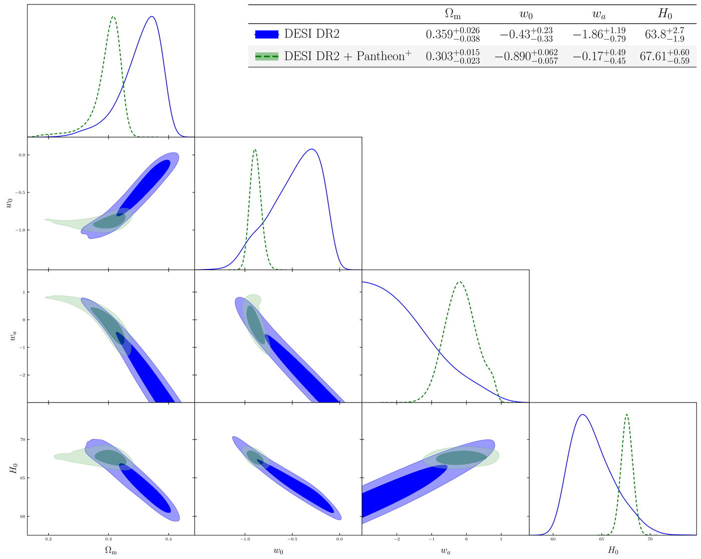
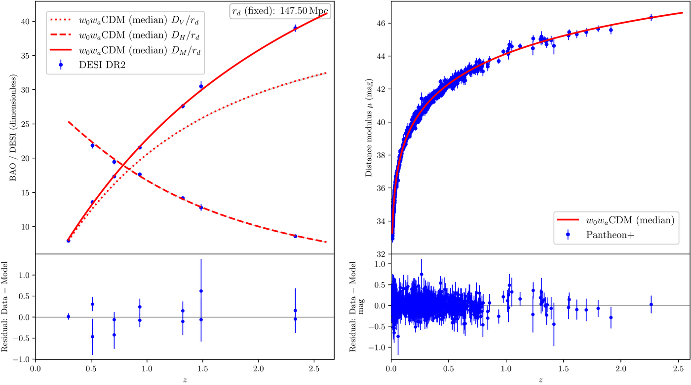

# Tutorial 1: $w_0w_a$CDM against ΛCDM with DESI DR2

The DESI DR2 BAO results (DESI Collaboration 2025, [arXiv:2503.14738](https://arxiv.org/abs/2503.14738)) compare evolving dark energy, $w(a) = w_0 + w_a(1-a)$, with a cosmological constant. This tutorial repeats two of their comparisons, DESI alone and DESI with Pantheon+, with the `wowaCDM_v` model that ships with Kosmulator. On the way it shows how Kosmulator handles $r_d$ without an early-time calibrator, and what to do when a chain has not converged. It takes about 15 minutes on two cores.

## 1. Settings

In `Kosmulator.py`:

```python
model_names: List[str] = ["wowaCDM_v"]

observations: List[List[str]] = [
    ["DESI_DR2"],
    ["DESI_DR2", "PantheonP"],
]

reference_model: str = "LCDM_v"

nwalkers: int = 32
nsteps: int = 10000
burn: int = 500
```

The priors of `w0` and `wa` in `prior_limits`, $w_0 \in [-3, 1]$ and $w_a \in [-3, 2]$, are those of DESI DR2, and the model requires $w_0 + w_a < 0$ (a coupled restriction in `User_defined_modules.py`), as DESI does.

```bash
python Kosmulator.py --output_suffix DESI_w0wa --plot_table --latex_enabled
```

## 2. $r_d$ without a calibrator

Neither group has an early-time calibrator (BBN or CMB), so the BAO measure only the product $H_0 r_d$. Kosmulator says so at start-up:

```text
WARNING |   BAO/DESI singleton: fixed r_d=147.5 Mpc and removed 'r_d' from parameters for ['DESI_DR2']
WARNING |   BAO/DESI uncalibrated: no H0 or r_d anchor, so H_0 measures h*r_d; fixed r_d=147.5 Mpc and removed 'r_d' from parameters for ['DESI_DR2', 'PantheonP']
```

$r_d$ is fixed at 147.5 Mpc, and the $H_0$ of these groups stands for $h\,r_d$; the tables also give $c/(H_0 r_d)$, which does not depend on that choice. Add `BBN_DH` or `ThetaStar_CMB` to a group to calibrate $r_d$ (see [Data sets](../tags.md#baryon-acoustic-oscillations)).

## 3. Sampling

ΛCDM (the reference model) is fitted first, then $w_0w_a$CDM. Three of the four fits meet the convergence rule well before `nsteps`:

```text
INFO | [LCDM_v | DESI_DR2] zeus converged, stopped at step 1100: tau_max = 5.0 (H_0), ...
INFO | [LCDM_v | DESI_DR2+PantheonP] zeus converged, stopped at step 1000: tau_max = 4.9 (Omega_m), ...
INFO | [wowaCDM_v | DESI_DR2] zeus converged, stopped at step 4300: tau_max = 36.1 (Omega_m), ...
```

The $w_0w_a$CDM posteriors are long and curved (see the corner plot below), so their autocorrelation times are 10 - 20 times those of ΛCDM.

## 4. A chain that has not converged

The fourth fit reached `nsteps` first:

```text
WARNING | [wowaCDM_v | DESI_DR2+PantheonP] zeus reached 10000 steps without meeting the convergence rule: tau_max = 106.8 (Omega_m), N_post/tau = 89 (needs >= 100: NOT MET); ESS = 2848 (needs >= 2000: ok); tau_max change since the previous check = 0.6% (needs < 5%: ok); split-Rhat = 1.0089 (Omega_m) (needs < 1.01: ok). Roughly 1177 more steps are needed at this tau_max. Treat these results as preliminary; increase nsteps.
```

The message says which condition failed (the chain is 89 autocorrelation times long, 100 are needed) and roughly how many more steps it needs. There is no need to start again: raise `nsteps` in `Kosmulator.py` (here to 14000) and continue the chain:

```bash
python Kosmulator.py --output_suffix DESI_w0wa --plot_table --latex_enabled --resume
```

The three converged chains are loaded as they are, and the fourth continues from its last step:

```text
[INFO] Zeus chain flagged converged → loading: MCMC_Chains/DESI_w0wa/LCDM_v/DESI_DR2/DESI_DR2_zeus.h5
[INFO] Zeus chain flagged converged → loading: MCMC_Chains/DESI_w0wa/LCDM_v/DESI_DR2_PantheonP/DESI_DR2+PantheonP_zeus.h5
[INFO] Zeus chain flagged converged → loading: MCMC_Chains/DESI_w0wa/wowaCDM_v/DESI_DR2/DESI_DR2_zeus.h5
INFO | [RESUME][Zeus] Loaded 10000 steps from MCMC_Chains/DESI_w0wa/wowaCDM_v/DESI_DR2_PantheonP/DESI_DR2+PantheonP_zeus.h5
INFO | [wowaCDM_v | DESI_DR2+PantheonP] zeus converged, stopped at step 10900: tau_max = 103.8 (Omega_m), N_post/tau = 100 (needs >= 100: ok); ESS = 3208 (needs >= 2000: ok); tau_max change since the previous check = 0.6% (needs < 5%: ok); split-Rhat = 1.0084 (Omega_m) (needs < 1.01: ok).
```

## 5. The posteriors



DESI alone allows a wide, curved range of $w_0$ and $w_a$ along its degeneracy direction, cut off by the $w_a$ prior at $-3$. Pantheon+ fixes $\Omega_m$ and shrinks the posterior to a small region around $w_0 \approx -0.9$. The table on the plot (from `--plot_table`) is also written to `aligned_table_pretty.txt`, together with the pivot redshift of each group:

```text
Parameter | DESI_DR2                  | DESI_DR2+Pantheon+
----------------------------------------------------------
Omega_m   | $0.359^{+0.026}_{-0.038}$ | $0.303^{+0.015}_{-0.023}$
w0        | $-0.43^{+0.23}_{-0.33}$   | $-0.890^{+0.062}_{-0.057}$
wa        | $-1.86^{+1.19}_{-0.79}$   | $-0.17^{+0.49}_{-0.45}$
H_0       | $63.8^{+2.7}_{-1.9}$      | $67.61^{+0.60}_{-0.59}$

Pivot of DESI_DR2: z_p = 0.36, w_p = -0.917 +- 0.075 (a_p = 1 + C(w0, wa) / C(wa, wa); mean and standard deviation).
Pivot of DESI_DR2+Pantheon+: z_p = 0.10, w_p = -0.902 +- 0.044 (a_p = 1 + C(w0, wa) / C(wa, wa); mean and standard deviation).
```



## 6. The model comparison

`interpretations_summary.txt` of `wowaCDM_v` compares it with the reference model, group by group:

```text
DESI_DR2+Pantheon+ [rd: fixed 147.5 Mpc]
------------------------------------------------------------------------------------------------
  Fit       χ² = 1411.28 for ν = 1598, χ²_ν = 0.883
            χ²_ν = 0.883 lies 3.3 σ below 1 (expected 1 ± 0.04 for 1598 dof; P(χ² <= observed) =
            3.0e-04). This is too low to be overfitting: a model with a few free parameters
            cannot absorb that much chi-squared. The usual cause is supernova covariances that
            include conservative systematic terms (PantheonP). Compare models with Δχ², σ and
            the information criteria rather than with the absolute χ²_ν. ...
  Δχ²          -4.90 with 2 extra parameters: 1.7σ (Slight consideration for the model)
  ΔAIC         -0.90  Indistinguishable
  ΔBIC         +9.86  Moderate evidence against the model
  ΔAICc        -0.88  Indistinguishable
  ΔDIC         -0.74  Indistinguishable
  ΔWAIC        -2.67  Slight evidence in favour of the model
```

Next to DESI DR2's Table VI:

| Data | Kosmulator $\Delta\chi^2$ | Kosmulator significance | Kosmulator $\Delta$DIC | DESI DR2 $\Delta\chi^2_\mathrm{MAP}$ | DESI DR2 significance | DESI DR2 $\Delta$DIC |
|---|---|---|---|---|---|---|
| DESI | -4.66 | 1.7$\sigma$ | -0.89 | -4.7 | 1.7$\sigma$ | -0.8 |
| DESI + Pantheon+ | -4.90 | 1.7$\sigma$ | -0.74 | -4.9 | 1.7$\sigma$ | -0.7 |

The parameters agree as well: for DESI + Pantheon+, DESI DR2's Table V gives $w_0 = -0.888^{+0.055}_{-0.064}$ and $w_a = -0.17 \pm 0.46$. (DESI quotes means and Kosmulator medians, which differ where a posterior is skewed, as for DESI alone.)

Two things are worth noting in the comparison. First, the criteria do not all agree: BIC penalises the two extra parameters with $\ln N$ for the 1600 supernovae and disfavours $w_0w_a$CDM, while $\Delta\chi^2$, AIC, DIC and WAIC lean slightly towards it. Second, the significance (1.7$\sigma$) is far from a detection with these data; DESI DR2's stronger preferences come from adding the CMB and other supernova samples. Groups such as `["DESI_DR2", "DESY5"]` or `["DESI_DR2", "Union3"]` can be added to `observations` to see this.
