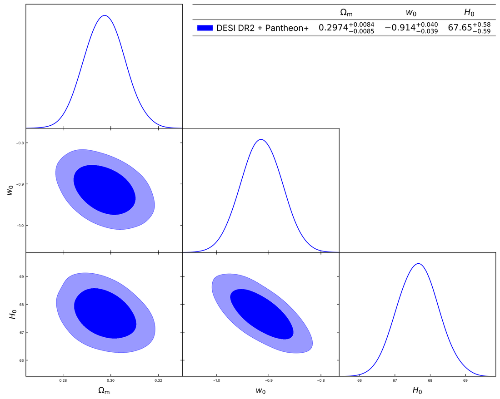

# Tutorial 2: Add your own model

This tutorial adds a new model to Kosmulator and fits it to data. The example is flat **wCDM**, dark energy with a constant equation of state $w_0$:

$$
E^2(z) = \Omega_m (1+z)^3 + \Omega_r (1+z)^4 + (1 - \Omega_m - \Omega_r)\,(1+z)^{3(1+w_0)} .
$$

Everything you need is in two files: the model goes in **`User_defined_modules.py`**, and the run settings in **`Kosmulator.py`**.

## 1. Write E(z)

Open `User_defined_modules.py` and find the section *Core E(z) models*, where `LCDM_MODEL_vectorised` and `wowaCDM_MODEL_vectorised` are. Add your function next to them:

```python
def wCDM_MODEL_vectorised(z: Number, p: Dict[str, float]) -> Number:
    r"""
    Flat wCDM: E^2(z) = Omega_m (1+z)^3 + Omega_r (1+z)^4 + (1 - Omega_m - Omega_r) (1+z)^{3(1+w0)}

    Parameters in `p`:
      - Omega_m
      - w0
    """
    z = _asarray(z)
    Om = float(p["Omega_m"])
    w0 = float(p["w0"])
    Or = radiation_density(p)

    E2 = Om * (1 + z) ** 3 + Or * (1 + z) ** 4 + (1 - Om - Or) * (1 + z) ** (3 * (1 + w0))

    if (not np.isfinite(E2).all()) or (E2.min() <= 0):
        out = np.full_like(z, np.nan)
    else:
        out = np.sqrt(E2)
    return _scalar_or_array(out)
```

A model function follows four simple rules:

1. It takes `z` (a number or a NumPy array of redshifts) and `p`, a dictionary of the parameters by name, and returns $E(z) = H(z)/H_0$.
2. `_asarray(z)` at the start and `_scalar_or_array(out)` at the end let the same function serve a single redshift and an array. Written with NumPy array operations, as above, the model is **vectorised**, which makes sampling much faster. Kosmulator detects this by itself.
3. `radiation_density(p)` gives $\Omega_r$ the same way for every model (from $H_0$, $T_\mathrm{CMB}$ and the neutrinos), so that your model and ΛCDM are compared on the same footing.
4. Return `NaN` for a point where the model is not defined or not physical. Kosmulator then rejects the point (the walker does not move there).

::::{dropdown} A model without a closed form
$E(z)$ does not need a formula: it can come from solving an equation numerically, as `f1CDM_MODEL_vectorised` does (Newton iterations on all redshifts at once). Write it to accept an array of redshifts if you can. If the model can only be evaluated one redshift at a time, it still works; Kosmulator then evaluates it point by point, through the worker pool, which is slower.
::::

## 2. Register the model

Scroll down to the section *Model registry / discovery* and add one line to `_MODEL_REGISTRY`, with the name you will use in `Kosmulator.py` and the list of the model's own parameters:

```python
_MODEL_REGISTRY: Dict[str, Tuple[Callable, List[str]]] = {
    # Background-only models
    "LCDM_v":   (LCDM_MODEL_vectorised,      ["Omega_m"]),
    ...
    "wowaCDM_v": (wowaCDM_MODEL_vectorised, ["Omega_m","w0","wa"]),
    "wCDM_v":   (wCDM_MODEL_vectorised,      ["Omega_m", "w0"]),
    ...
}
```

List only the model's own parameters. $H_0$ and the parameters the data need ($r_d$, the supernova calibration, CMB parameters and nuisances) are added by Kosmulator according to the data in each group.

## 3. Priors and reference values

Every sampled parameter needs a flat prior in `prior_limits` in `Kosmulator.py`, and preferably a reference value (the starting point of the walkers' pre-fit). `w0` is already there, since `wowaCDM_v` uses it:

```python
prior_limits = {
    ...
    'w0': (-3.0, 1.0),
    ...
}
reference_values = {
    ...
    "w0": -1.0,
}
```

For a parameter with a new name, add it to both dictionaries. If you forget the prior, Kosmulator stops at start-up and tells you which one to add.

## 4. Optional: restrictions

A top-hat prior is a box. Conditions that a box cannot express go in the *Model restrictions* section of `User_defined_modules.py`:

- `restrictions_map` holds conditions on **one** parameter, as a function that returns `True` when the value is allowed;
- `coupled_restrictions_map` holds conditions on **several** parameters, as a function of the whole parameter dictionary.

For wCDM, the same loose condition on $\Omega_m$ as ΛCDM:

```python
restrictions_map: Dict[str, Dict[str, Callable[[float], bool]]] = {
    ...
    "wowaCDM_v": {"Omega_m": restrict_LCDM_Omega_m},
    "wCDM_v": {"Omega_m": restrict_LCDM_Omega_m},
}
```

and, as an example of a coupled restriction, the one `wowaCDM_v` uses ($w_0 + w_a < 0$, so that dark energy does not dominate at early times):

```python
def restrict_wowa_sum(p: Dict[str, float]) -> bool:
    w0 = float(p.get("w0", -1.0))
    wa = float(p.get("wa", 0.0))
    if w0 + wa >= 0.0:
        return False
    return True

coupled_restrictions_map = {
    "wowaCDM_v": [restrict_wowa_sum],
}
```

Restrictions are optional: returning `NaN` from the model function has the same effect.

## 5. Run it

In `Kosmulator.py`:

```python
model_names: List[str] = ["wCDM_v"]

observations: List[List[str]] = [
    ['DESI_DR2', 'PantheonP'],
]

reference_model: str = "LCDM_v"
```

and run:

```bash
python Kosmulator.py --output_suffix wCDM_tutorial --plot_table
```

Kosmulator fits `LCDM_v` (the reference model) and then `wCDM_v`. At start-up it checks that the model is vectorised and lists the parameters of each group:

```text
INFO | Models (ordered): ['LCDM_v', 'wCDM_v']
INFO | Observations: [['DESI_DR2', 'PantheonP']]
INFO | Sampler: nwalkers=32 nsteps=5000 burn=200 conv=0.05000
INFO | Parameter injections (identical for all models; added automatically from dataset requirements)
WARNING |   ['DESI_DR2', 'PantheonP']  → H_0,r_d
INFO | Policy decisions (identical for all models)
WARNING |   BAO/DESI uncalibrated: no H0 or r_d anchor, so H_0 measures h*r_d; fixed r_d=147.5 Mpc and removed 'r_d' from parameters for ['DESI_DR2', 'PantheonP']
INFO | Model 'LCDM_v' vectorised: True
INFO | Model 'wCDM_v' vectorised: True
INFO |   Model 'wCDM_v': engine zeus (vectorised=True, touches CMB/BBN=False)
```

If your model shows `vectorised: False`, it still runs, but more slowly; check that it accepts an array of redshifts.

```text
INFO | [wCDM_v | DESI_DR2+PantheonP] zeus converged, stopped at step 1100: tau_max = 8.3 (w0), N_post/tau = 108 (needs >= 100: ok); ESS = 3464 (needs >= 2000: ok); tau_max change since the previous check = 1.5% (needs < 5%: ok); split-Rhat = 1.0094 (Omega_m) (needs < 1.01: ok).
INFO | [wCDM_v | DESI_DR2+PantheonP] zeus sampling took 1:11 minutes
```

## 6. The results

The corner plot, with the table from `--plot_table`:



DESI DR2's Table V gives $\Omega_m = 0.2976 \pm 0.0087$ and $w = -0.914 \pm 0.040$ for wCDM with DESI + Pantheon+, so the few lines above reproduce their result.

`interpretations_summary.txt` compares the model with ΛCDM:

```text
DESI_DR2+Pantheon+ [rd: fixed 147.5 Mpc]
------------------------------------------------------------------------------------------------
  Fit       χ² = 1411.52 for ν = 1599, χ²_ν = 0.883
            ...
  Δχ²          -4.66 with 1 extra parameter: 2.2σ (Considerable consideration for the model)
  ΔAIC         -2.66  Slight evidence in favour of the model
  ΔBIC         +2.72  Weak evidence against the model
  ΔAICc        -2.65  Slight evidence in favour of the model
  ΔDIC         -2.69  Slight evidence in favour of the model
  ΔWAIC        -4.49  Positive evidence in favour of the model
```

Negative differences favour wCDM. With one extra parameter the $\chi^2$ improvement of 4.66 corresponds to 2.2$\sigma$; AIC, DIC and WAIC prefer wCDM slightly, while BIC, which penalises each parameter with $\ln N$ for about 1600 data points, prefers ΛCDM. [Outputs and statistics](../outputs.md) explains each criterion.

## 7. Going further

Your model can do more than $E(z)$. Each extra is a separate function in `User_defined_modules.py`, found by its name:

| Function | Used for | Without it |
|---|---|---|
| `<model>_Geff(z, p)` | $G_\mathrm{eff}/G$ for the growth data with `growth_model = "geff"` | the growth follows GR ($G_\mathrm{eff} = G$) on the model's expansion history, and Kosmulator warns |
| `<model>_dlnE(z, p)` | the exact $d\ln E/d\ln a$ for the growth equation | it is computed numerically from $E(z)$ |
| `<model>_CMB(p, mode)` | CMB spectra from CLASS, for any CMB data | CMB data cannot be used with the model |

`f1CDM_v_Geff`, `LCDM_v_dlnE` and `wowaCDM_v_dlnE` in `User_defined_modules.py` are worked examples. The CMB helper is the subject of [Tutorial 3](cmb_model.md).
